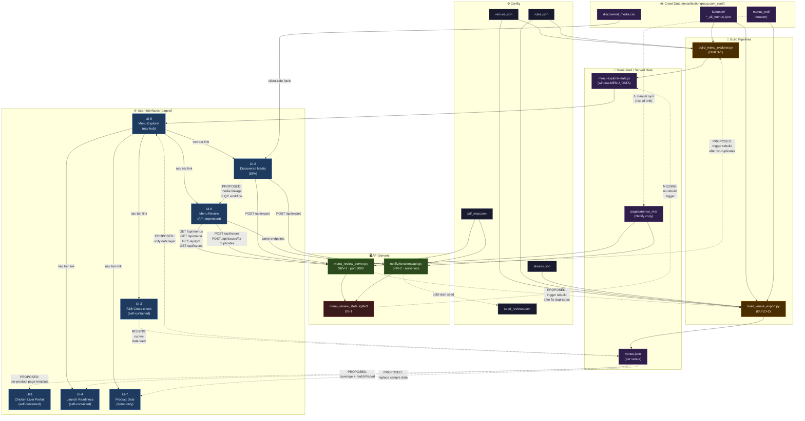

# 05 — Component Relationships

> **Knowledge Base** · Inn Collection Group (ICG) Hospitality Technology Workspace  
> **Document** 5 of 10 · Last updated: 2026-11-22  
> **Evidence key:** [CODE-VERIFIED] · [OBSERVED] · [INFERRED] · [PROPOSED]

---

## 1. Overview

The ICG workspace is a collection of seven user-facing interfaces backed by two API servers, three build pipelines, and a shared crawl data directory. At present, the components are only loosely coupled: one of them (Menu Explorer) provides a navigation bar linking to the others, two of them (Menu Review and Discovered Media) share an API layer, and the rest operate in self-contained isolation. A proposed target architecture would promote `venue.json` to the role of a canonical shared data layer, connecting all interfaces through a common, build-generated source of truth.

---

## 2. Component Inventory

| ID | Component | Kind | Isolation |
|----|-----------|------|-----------|
| **UI-1** | Chicken Liver Parfait | Static HTML page | Fully self-contained |
| **UI-2** | Discovered Media | SPA (no external JS deps) | API-dependent (export only) |
| **UI-3** | F&B Role Cross-check | Static SPA | Fully self-contained |
| **UI-4** | Launch Readiness | Static SPA | Fully self-contained |
| **UI-5** | Menu Explorer | SPA + JS data module | Build-pipeline-dependent |
| **UI-6** | Menu Review | SPA | Fully API-dependent |
| **UI-7** | Product Data | Static SPA | Fully self-contained (demo) |
| **SRV-1** | `menu_review_server.py` | Python ThreadingHTTPServer (port 8000) | Local dev only |
| **SRV-2** | `netlify/functions/api.py` | Serverless (AWS Lambda via Netlify) | Production |
| **DB-1** | `menu_review_state.sqlite3` | SQLite | Shared between server instances |
| **BUILD-1** | `build_menu_explorer.py` | Python build script | Offline pipeline |
| **BUILD-2** | `build_venue_export.py` | Python build script (1 376 lines) | Offline pipeline |
| **DATA-1** | `kafoodie/*_all_menus.json` | Crawled outlet JSON | Source of truth for product data |
| **DATA-2** | `menus_md/` | Markdown menus (master) | Shared between pipelines |
| **DATA-3** | `pages/menus_md/` | Markdown menus (Netlify copy) | Served statically |
| **DATA-4** | `discovered_media.csv` | Crawled media asset list | Loaded client-side |
| **DATA-5** | `menu-explorer-data.js` | Generated JS data module | Consumed by Menu Explorer |
| **DATA-6** | `venue.json` (per venue) | Build output | Currently unused by interfaces |
| **CFG-1** | `config/venues.json` | Per-venue overrides | Consumed by build scripts |
| **CFG-2** | `config/aliases.json` | Dish-name mappings | Consumed by build scripts |
| **CFG-3** | `config/rules.json` | Parsing rules | Consumed by build scripts |
| **CFG-4** | `pdf_map.json` | MD → PDF path map | Consumed by Menu Review |
| **CFG-5** | `seed_reviews.json` | Pre-seeded review records | Consumed by SRV-2 at cold start |

---

## 3. Existing Connections [CODE-VERIFIED]

### 3.1 Navigation Hub

[CODE-VERIFIED] `pages/menu-explorer.html` contains a navigation bar with hard-coded `<a>` links to every other interface:

```
menu-explorer.html  ──→  menu-review.html
                    ──→  discovered-media.html
                    ──→  fnb-crosscheck.html
                    ──→  launch-readiness.html
                    ──→  product-data.html
```

Navigation is **unidirectional**: Menu Explorer is the only hub. No other interface links back to Menu Explorer or to each other.

---

### 3.2 API Layer (Menu Review)

[CODE-VERIFIED] `pages/menu-review.html` calls the following endpoints at runtime:

| Method | Endpoint | Purpose |
|--------|----------|---------|
| `GET` | `/api/menus` | Lists all `.md` files from `menus_md/` |
| `GET` | `/api/menu?name=` | Returns raw Markdown content |
| `GET` | `/api/pdf?name=` | Streams PDF bytes (resolved via `pdf_map.json`) |
| `GET` | `/api/issues` | Returns detected issues for a menu |
| `POST` | `/api/issues` | Persists review status to SQLite (`DB-1`) |
| `POST` | `/api/issues/fix-duplicates` | Rewrites the `.md` file to remove duplicate lines |

Both `SRV-1` and `SRV-2` implement these routes identically. `SRV-2` additionally seeds `DB-1` from `seed_reviews.json` on cold start.

---

### 3.3 API Layer (Discovered Media)

[CODE-VERIFIED] `pages/discovered-media.html`:

- Loads `discovered_media.csv` directly at page load (client-side `fetch`, no API call).
- Calls `POST /api/export` when the user triggers a batch export. `SRV-1` downloads files to a local `exports/` folder; `SRV-2` returns a base64-encoded ZIP in the response body.

---

### 3.4 Build Pipeline → Menu Explorer

[CODE-VERIFIED] `build_menu_explorer.py` reads all `kafoodie/*_all_menus.json` outlet files, deduplicates by `outlet_id`, resolves a shared allergen definitions map, and writes `pages/menu-explorer-data.js` (exported as `window.MENU_DATA`). Menu Explorer loads this file synchronously as a `<script>` tag. `ALL_MENUS_CHECKLIST.md` is a secondary output for auditing purposes.

```
DATA-1 (kafoodie/*.json)
    + CFG-1 (venues.json)
    + CFG-3 (rules.json / FILTER_NAMES)
        ──[BUILD-1]──→  DATA-5 (menu-explorer-data.js)  ──→  UI-5 (Menu Explorer)
                    ──→  ALL_MENUS_CHECKLIST.md
```

---

### 3.5 Build Pipeline → Venue Export

[CODE-VERIFIED] `build_venue_export.py` reads the same `kafoodie/*.json` source data, then parses every `menus_md/*.md` file using the MENU-MD-SPEC format. It matches printed dish names to Kafoodie recipes using a three-stage cascade: `aliases.json` lookup → exact name match → token overlap score. Output is one `venue.json` and one `venue.md` per venue written to `exports/<Region>/<Venue>/`.

```
DATA-1 (kafoodie/*.json)
    + DATA-2 (menus_md/ — master)
    + CFG-2 (aliases.json)
    + CFG-3 (rules.json)
    + CFG-1 (venues.json)
        ──[BUILD-2]──→  DATA-6 (venue.json per venue)   [currently unconsumed]
                    ──→  venue.md per venue              [currently unconsumed]
```

---

### 3.6 Shared Markdown Source

[CODE-VERIFIED] `inncollectiongroup.com_root/menus_md/` (master copies) and `pages/menus_md/` (Netlify-served copies) appear to be duplicates. Both directories are consumed:

- `pages/menus_md/`: served statically to the browser by Netlify; API server reads from this path for `GET /api/menu` and `POST /api/issues/fix-duplicates`.
- `inncollectiongroup.com_root/menus_md/`: used as the input path by `build_venue_export.py`.

> [!WARNING]
> Any edit applied by **Menu Review's** `fix-duplicates` endpoint modifies `pages/menus_md/` but does **not** propagate to `inncollectiongroup.com_root/menus_md/`. The two directories can silently drift unless a manual sync step is performed before running `build_venue_export.py`.

---

### 3.7 PDF Map

[CODE-VERIFIED] `pages/pdf_map.json` maps each `.md` filename to its corresponding PDF path. This file is read by both API servers to resolve `GET /api/pdf?name=` requests.

---

### 3.8 SQLite Database

[CODE-VERIFIED] `DB-1` (`menu_review_state.sqlite3`) stores:

```sql
issue_reviews(menu_name, source_hash, issue_id, status, note, updated_at)
```

It is written by `SRV-1` at runtime and by `SRV-2` on cold start (via `seed_reviews.json`). No other component reads or writes this database.

---

## 4. Proposed Connections [PROPOSED]

The following connections do not yet exist in code but represent the logical target architecture where `venue.json` becomes the canonical shared data layer.

### 4.1 `venue.json` as Universal Data Source

[PROPOSED] `venue.json` already contains the richest representation of each venue's menus, products, allergens, nutrition, pricing, and coverage statistics. All interfaces that currently embed sample data or read from disjoint sources should instead consume `venue.json`:

| Interface | Data to consume from `venue.json` |
|-----------|-----------------------------------|
| **Menu Explorer** | `menus[]`, `products[]`, `allergens[]` → replace `menu-explorer-data.js` or unify build |
| **Product Data** | `products[]` with full allergen, nutrition, pricing, validation data |
| **Launch Readiness** | `coverage.*`, `matchReport.*` for real completion percentages and gap lists |
| **Chicken Liver Parfait** | Template for individual `products[id]` pages generated from `venue.json` |

---

### 4.2 Edit-Triggered Rebuilds

[PROPOSED] When a menu file is corrected via Menu Review's `fix-duplicates` endpoint, the correction should propagate automatically:

```
Menu Review (fix-duplicates)
    ──→  sync pages/menus_md/ → inncollectiongroup.com_root/menus_md/
    ──→  trigger BUILD-2 (build_venue_export.py)
    ──→  trigger BUILD-1 (build_menu_explorer.py)
    ──→  redeploy pages/ to Netlify
```

This closes the loop between QC editing and published data.

---

### 4.3 Discovered Media → Menu Review Workflow

[PROPOSED] Assets discovered in `discovered_media.csv` (logos, food photography, PDFs) should be linkable from within the Menu Review workflow so that a reviewer can annotate a menu with its associated media assets and flag missing photography.

---

### 4.4 F&B Cross-check → Live Requirements

[PROPOSED] The 100+ operational requirements currently embedded as a JSON blob in `fnb-crosscheck.html` could be externalised to a versioned config file (e.g. `config/requirements.json`) shared with `venue.json`'s `gaps[]` array, so that coverage classifications reflect actual build-pipeline output.

---

## 5. Missing Connections (Gaps) [CODE-VERIFIED / INFERRED]

| Gap | Impact |
|-----|--------|
| Menu Review edits do not trigger Menu Explorer rebuild | A reviewed/corrected menu never appears updated in the Explorer |
| `venue.json` is not consumed by any interface | 1 376 lines of parsing logic produce output that nothing reads |
| Product Data is disconnected from Kafoodie and `venue.json` | Interface shows hardcoded demo data only |
| Launch Readiness is fully isolated | Completion percentages are fictional; no real milestone data |
| F&B Cross-check maintains its own embedded dataset | Cannot be kept in sync with actual software capabilities automatically |
| No feedback from Discovered Media to Menu Review | Broken links and missing PDFs found in the crawl are invisible to QC reviewers |
| No shared auth or user context | No concept of "who reviewed this menu" across interfaces |
| `pages/menus_md/` and `inncollectiongroup.com_root/menus_md/` can diverge | Build outputs reflect different source than what Menu Review shows |
| `config/venues.json` has only 3 of ~31 venue overrides | Most venues lack explicit config; build scripts rely on inferred names |

---

## 6. Shared Dependencies

```
Shared by ALL interfaces at runtime:
  SRV-1 / SRV-2  →  all pages/* routes

Shared by Menu Review + Discovered Media:
  SRV-1 / SRV-2  (API layer)
  DB-1            (SQLite — Menu Review only writes; Discovered Media does not use DB)

Shared by BUILD-1 + BUILD-2:
  DATA-1  kafoodie/*_all_menus.json
  CFG-1   config/venues.json
  CFG-3   config/rules.json

Shared by Menu Review (runtime) + BUILD-2 (offline):
  DATA-2 / DATA-3  menus_md/ (master vs Netlify copy — risk of drift)

Shared by SRV-1 + SRV-2:
  CFG-4   pdf_map.json
  CFG-5   seed_reviews.json  (SRV-2 only on cold start)
```

---

## 7. Architecture Diagram

The diagram below uses three arrow styles:

- **Solid arrows** (`-->`) — existing connections [CODE-VERIFIED]
- **Dashed arrows** (`-.->`) — proposed connections [PROPOSED]
- **Dotted-style dashed arrows** with `Missing` label — absent connections that represent gaps



---

## 8. Connection Summary Table

| Source | Target | Type | Evidence |
|--------|--------|------|----------|
| `kafoodie/*.json` | `build_menu_explorer.py` | Data input | [CODE-VERIFIED] |
| `kafoodie/*.json` | `build_venue_export.py` | Data input | [CODE-VERIFIED] |
| `menus_md/` (master) | `build_venue_export.py` | Data input | [CODE-VERIFIED] |
| `pages/menus_md/` | API servers | Static file serving | [CODE-VERIFIED] |
| `menus_md/` master ↔ `pages/menus_md/` | (manual sync) | Duplication risk | [INFERRED] |
| `config/aliases.json` | `build_venue_export.py` | Matching config | [CODE-VERIFIED] |
| `config/venues.json` | Both build scripts | Override config | [CODE-VERIFIED] |
| `config/rules.json` | Both build scripts | Parsing config | [CODE-VERIFIED] |
| `pdf_map.json` | Both API servers | PDF path resolution | [CODE-VERIFIED] |
| `seed_reviews.json` | `api.py` (SRV-2) | Cold-start seeding | [CODE-VERIFIED] |
| `build_menu_explorer.py` | `menu-explorer-data.js` | Build output | [CODE-VERIFIED] |
| `build_venue_export.py` | `venue.json` (per venue) | Build output | [CODE-VERIFIED] |
| `menu-explorer-data.js` | Menu Explorer (UI-5) | JS data module | [CODE-VERIFIED] |
| Menu Explorer | All other UIs | HTML nav bar links | [CODE-VERIFIED] |
| Menu Review | API servers | XHR/fetch calls | [CODE-VERIFIED] |
| Discovered Media | API servers | POST /api/export | [CODE-VERIFIED] |
| Discovered Media | `discovered_media.csv` | Client-side fetch | [CODE-VERIFIED] |
| API servers | SQLite (DB-1) | Read/write state | [CODE-VERIFIED] |
| `venue.json` | Menu Explorer | Unify data layer | [PROPOSED] |
| `venue.json` | Product Data | Replace demo data | [PROPOSED] |
| `venue.json` | Launch Readiness | Real coverage data | [PROPOSED] |
| `venue.json` | Chicken Liver Parfait | Per-product template | [PROPOSED] |
| Menu Review fix → rebuild | Build pipelines | Edit-triggered CI | [PROPOSED] |
| Discovered Media | Menu Review | Media linkage | [PROPOSED] |
| Menu Review → Menu Explorer | (rebuild trigger) | Edit feedback loop | **MISSING** |
| F&B Cross-check | `venue.json` / live data | Live requirements | **MISSING** |
| Launch Readiness | Any backend | Real milestone data | **MISSING** |
| Product Data | Kafoodie / `venue.json` | Real product data | **MISSING** |

---

## 9. Key Architectural Observations

> [!IMPORTANT]
> **`venue.json` is the workspace's most complete data artefact and is consumed by nothing.** `build_venue_export.py` is the most sophisticated component (1 376 lines, three-stage name-matching, full schema v1.0.0 output) yet its output is unreachable from any interface. Closing this gap is the single highest-leverage architectural change available.

> [!WARNING]
> **The `menus_md/` duplication is a correctness hazard.** Menu Review's `fix-duplicates` writes to `pages/menus_md/` but `build_venue_export.py` reads from `inncollectiongroup.com_root/menus_md/`. The two paths can diverge silently, meaning build output may not reflect reviewed/corrected content.

> [!NOTE]
> **Menu Explorer is the de-facto shell.** Because it is the only page with a navigation bar, it functions as the workspace's application shell even though it is architecturally just one of seven peers. Any move toward a unified SPA or shared layout component should start here.

> [!TIP]
> **The Chicken Liver Parfait page is the proof-of-concept for a product record UI.** Its hub-and-spoke UX (sections as buttons expanding into detail sheets) is a strong pattern that could be generated from `venue.json`'s `products[]` array — one static HTML page per product, built by an extension of `build_venue_export.py`.
