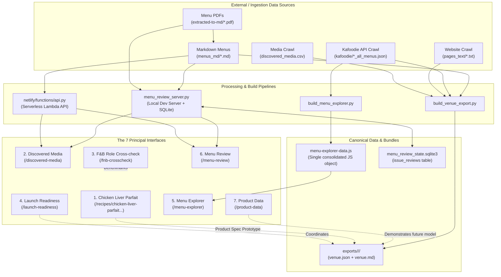

# 01 — Project Overview

## 1. Project Purpose & Strategic Vision

The **Inn Collection Group (ICG)** operates an expanding estate of approximately 31 premier pub and hotel coaching inns across Northern England (Northumberland, County Durham, Cumbria/Lake District, Yorkshire, Lancashire, Tyne and Wear) and North Wales. 

The primary business objective of this technology capability workspace is to **bridge the critical operational and data divide** between:
1. Physical and guest-facing artifacts (printed menus, daily specials boards, PDF collateral, promotional campaigns).
2. Central recipe management, food safety, and compliance records (Kafoodie recipe database, allergen matrices, nutritional analyses, supplier specs).
3. Site-level execution across 31 individual kitchens, front-of-house teams, and general managers.
4. Commercial operations, menu engineering, EPOS preparation, stock control, and procurement.

Historically in multi-site hospitality, printed menus are published via creative marketing pipelines, whilst culinary recipes live in separate software (such as Kafoodie). This creates frequent discrepancy, legal vulnerability regarding allergen declarations, lag in price changes, and administrative burden during seasonal menu launches. This project develops a unified hospitality technology workspace that brings discovery, quality assurance, structured data modeling, cross-site auditing, and operational launch readiness into a coherent ecosystem.

---

## 2. Operational Context & Domain Scope

The system addresses the end-to-end lifecycle of Food & Beverage operations:

* **Menu Document Intake & Auditing**: Scraping, indexing, and quality-assuring physical menu PDFs (`documents/extracted-to-md/`) and converting them to structured Markdown format (`menus_md/`).
* **Recipe Specifications & Culinary Knowledge**: Managing standard operating procedures (SOPs), ingredient breakdowns, portion standards, chef techniques, and visual plate presentation.
* **Food Safety, Allergens & Compliance**: Reconciling the 14 statutory allergens (`Gluten`, `Crustaceans`, `Eggs`, `Fish`, `Peanuts`, `Soya`, `Milk`, `Nuts`, `Celery`, `Mustard`, `Sesame`, `Sulphur dioxide`, `Lupin`, `Molluscs`), tracking "contains" vs "may-contain", identifying undeclared items (`is_pw_allergen_not_set`), and nutritional reporting per serving and per 100g.
* **Commercial & Price Architecture**: Reconciling printed menu prices against central pricing strategies, VAT treatment, margin targets, and drink portion scales (Bottle, 250ml, 175ml).
* **Cross-Site Variance & Brand Consistency**: Tracking localized recipe differences, regional heritage dish variations, and menu consistency across distinct property clusters (Crown menus, Heritage menus, Signature dining).
* **Launch Coordination**: Orchestrating seasonal rollouts (e.g. Autumn/Winter 2026, Christmas Day Lunch) across kitchens, front-of-house briefing, EPOS programming, and marketing media distribution.

---

## 3. Intended User Personas & Responsibilities

| Persona | Operational Focus | Key Needs in the Workspace |
| :--- | :--- | :--- |
| **Central F&B Leadership (Director / Executive Chef)** | Menu engineering, brand consistency, GP targets, supplier negotiation, compliance oversight. | High-level compliance visibility, cross-venue discrepancy audits, launch tracking, margin reporting. |
| **Head Chefs / Kitchen Teams** | Day-to-day recipe preparation, plating standards, allergen cross-checks, portion control, order scheduling. | Clear recipe specs (e.g., Chicken Liver Parfait presentation), ingredient codes, prep steps, plating images, allergen verification. |
| **General Managers & Front of House** | Guest allergen queries, menu navigation, table service standards, dietary accommodations. | Instant dish search, guest-facing allergen matrix, dietary filtering (vegan, GF, low-sugar), accurate dish descriptions. |
| **F&B Systems & Operational Coordinators** | EPOS programming, menu document review, data migration, software gap analysis. | Side-by-side PDF/Markdown diffing, duplicate line cleaners, automated recipe-to-menu item matching, export pipelines. |

---

## 4. Existing Components & System Topology

The current repository represents a hybrid environment of static frontend interfaces, Python data-processing pipelines, local SQLite persistence, and Netlify serverless deployment:

---

## 5. Architectural Direction: From Disconnected Tools to a Unified Capability Workspace

The project is transitioning from a set of seven disconnected prototypes and scripts into an integrated **Hospitality Technology Capability Workspace**:

1. **Unification of Canonical Data**: Establishing `venue.json` (produced by `build_venue_export.py`) as the single source of truth reconciling physical menu lines with Kafoodie recipe IDs.
2. **Document Lifecycle Closure**: Connecting `menu-review.html` QC decisions directly into the Markdown source and triggering automated rebuilds of downstream exports.
3. **Product-Centric Record Standard**: Elevating the rich visual and operational depth demonstrated in the Chicken Liver Parfait showcase into a reusable, database-backed product record format (`product-data.html`).
4. **Automated Audit & Compliance Gates**: Transitioning manual gap checking and allergen verification into rule-driven and AI-assisted review workflows.
5. **Role-Driven Navigation**: Providing purpose-built perspectives (Head Chef, General Manager, Compliance Officer, Operational Director) without duplicating core data.

---

## 6. Core Design Principles

1. **Software Adapts to Operations**: Hospitality professionals work in fast-paced, high-pressure environments. Interfaces must favor instant clarity, keyboard shortcuts, mobile/tablet ergonomics, and zero administrative bloat over rigid clerical workflows.
2. **Explicit Provenance for Food Safety**: Allergen, dietary, and nutritional declarations must have unambiguous, auditable provenance. Suggestions generated by heuristics or AI models must remain advisory until explicitly approved by culinary authority.
3. **Zero-Dependency Resilience**: Core web interfaces run with zero external frontend framework lock-in (vanilla JavaScript, native CSS grid/flexbox, native web standards), ensuring offline resilience, instant loading times, and zero build tool fragility.
4. **Single Source of Truth, Multiple Presentations**: The same underlying dish definition drives kitchen recipe specs, PDF menu lines, guest-facing allergen filters, EPOS buttons, and launch checklists.
