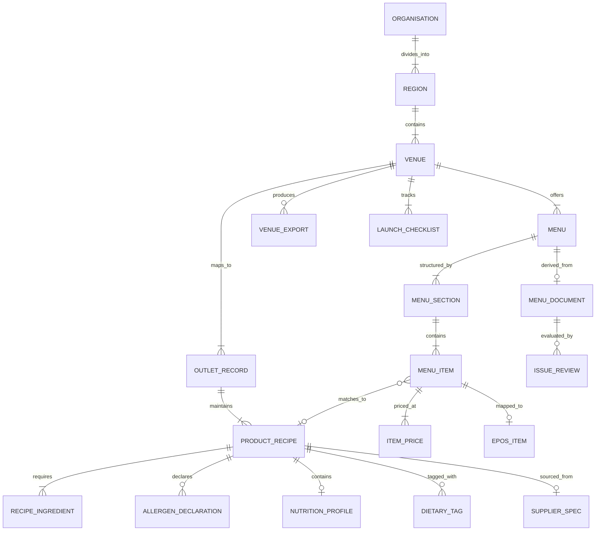

# 03 — Information Architecture

## 1. Unified Conceptual Model

The hospitality workspace coordinates information across multiple operational dimensions: physical sites, printed paper menus, digital recipe and food-safety databases, media assets, and commercial pricing.

### Entity-Relationship Diagram

---

## 2. Principal Entity Catalog

### 2.1 Spatial & Organisational Entities

#### `Organisation`
* **Purpose**: Top-level corporate entity representing The Inn Collection Group.
* **Attributes**: `id`, `name` ("The Inn Collection Group"), `headquarters`, `brand_guidelines`.
* **Implementation Status**: `[INFERRED]`. Represented implicitly across the estate.

#### `Region`
* **Purpose**: Geographic clustering for operations, supply chains, and localized menu offerings.
* **Attributes**: `name` (e.g., "Northumberland", "County Durham", "Lake District", "Yorkshire", "Lancashire", "Tyne and Wear", "North Wales").
* **Implementation Status**: `[CODE-VERIFIED]`. Implemented in `config/venues.json`, `build_venue_export.py`, and `pages/discovered-media.html`.

#### `Venue / Site`
* **Purpose**: The physical pub or hotel property where food and drinks are prepared and served.
* **Attributes**: `id` (slug, e.g. `the-kingslodge-inn`), `name`, `discoveredName`, `region`, `outletId` (Kafoodie ID, e.g. 15900), `website`, `address` (street, city, postcode), `phone`, `amenities`, `servingTimes`.
* **Data Ownership**: Master metadata defined in `config/venues.json` and Kafoodie `outlet_metadata`.
* **Implementation Status**: `[CODE-VERIFIED]`. Canonical representation generated in `exports/<Region>/<Venue>/venue.json`.

---

### 2.2 Menu & Document Entities

#### `Menu`
* **Purpose**: A curated collection of dishes and beverages served during specific dayparts or seasons at a venue.
* **Attributes**: `id` (e.g. `heritage-menu-the-kingslodge-inn-digital-web`), `name`, `kind` (`Food`, `Drinks`, `Sunday`, `Breakfast`, `Events`, `Other`), `source` (file paths to markdown and PDF), `stats`.
* **Implementation Status**: `[CODE-VERIFIED]`. Parsed from Markdown files by `build_venue_export.py` adhering to `docs/MENU-MD-SPEC.md`.

#### `Menu Section`
* **Purpose**: A thematic grouping of dishes as printed on the physical menu (e.g. "LIGHT BITES", "STARTERS", "MAINS", "ROASTS").
* **Attributes**: `name`, `level` (heading depth 2–4), `page` (PDF page number), `columns` (price labels, e.g. `["Bottle", "250ml", "175ml"]`), `notes`.
* **Implementation Status**: `[CODE-VERIFIED]`. Implemented in `build_venue_export.py:386-501`.

#### `Menu Item (Printed Dish Line)`
* **Purpose**: A discrete entry on a physical or digital menu as viewed and ordered by a guest.
* **Attributes**: `name`, `kind` (`dish`, `drink`, `promo`, `heading`, `grouping`), `dietary` (codes printed on paper: `V`, `VG`, `GFA`), `recommended` (boolean, crown ♛ symbol), `prices` (array of raw and float amounts), `description`, `notes`, `page`, `product` (matched recipe reference).
* **Data Ownership**: The printed menu PDF / Markdown file.
* **Implementation Status**: `[CODE-VERIFIED]`. Implemented in `build_venue_export.py:337-384`.

#### `Menu Document & Review (QC)`
* **Purpose**: The physical menu artifact (PDF) and its extracted digital twin, together with quality-control annotations.
* **Attributes**: `menu_name` (filename), `source_hash` (SHA256 of file contents), `issue_id` (`headings`, `list_entries`, `pdf_missing`, `repeated_lines`, `unusual_chars`), `status` (`open`, `fixed`, `intentional`), `note`, `updated_at`.
* **Data Ownership**: SQLite database `menu_review_state.sqlite3:issue_reviews`.
* **Implementation Status**: `[CODE-VERIFIED]`. Fully implemented in `menu_review_server.py` and `netlify/functions/api.py`.

---

### 2.3 Product & Recipe Entities

#### `Product / Recipe (Culinary Master Record)`
* **Purpose**: The authoritative culinary specification of a prepared food or drink item, containing ingredients, food-safety data, and nutritional values.
* **Attributes**: `id` (Kafoodie recipe ID, e.g. 5323684), `name`, `menuGroup`, `menuGroupId`, `description`, `photo`, `allergens` (array of contains), `mayContain` (array of cross-contact risks), `nutrition` (per serving & per 100g), `dietaryTags`, `isPublic`, `allergenDataMissing` (`is_pw_allergen_not_set`).
* **Data Ownership**: Kafoodie Recipe Management Platform.
* **Implementation Status**: `[CODE-VERIFIED]`. Extracted and cached in `build_menu_explorer.py` and `build_venue_export.py:551-584`.

#### `Ingredient & Supplier Spec`
* **Purpose**: Raw materials purchased from approved food suppliers to prepare a recipe.
* **Attributes**: `ingredient_id`, `supplier_code` (e.g. Brakes product code), `supplier_name`, `pack_size`, `yield_pct`, `storage_temp`, `shelf_life_days`.
* **Implementation Status**: `[OBSERVED]` in `pages/recipes/chicken-liver-parfait-the-lindisfarne-inn.html` as hardcoded HTML data; `[PROPOSED]` for universal integration into central product models.

#### `Allergen Reference & Assessment`
* **Purpose**: The reference taxonomy of regulated food allergens versus the empirical composition of a specific dish.
* **Attributes**:
  * *Statutory Allergen*: `id`, `name`, `label`, `abbr`, `is_may_contain`, `primaryId` (parent allergen ID for sub-allergens like Wheat -> Gluten), `sortOrder`.
  * *Dish Assessment*: Boolean flags indicating direct presence vs may-contain advisory.
* **Data Ownership**: UK Food Standards Agency regulations (taxonomy) / Chef recipe spec (assessment).
* **Implementation Status**: `[CODE-VERIFIED]`. Canonical map extracted by `build_menu_explorer.py` and consumed by `pages/menu-explorer.html`.

---

### 2.4 Commercial & Launch Entities

#### `Price Architecture`
* **Purpose**: Commercial financial specifications for dishes and drinks.
* **Attributes**: `raw` (string as printed, e.g. `£14.50`), `amount` (float), `label` (size/format), `vat_rate` (standard 20%), `target_gp_pct` (e.g. 72%), `cost_price`.
* **Implementation Status**: `[CODE-VERIFIED]` for printed menu amounts; `[INFERRED]` / `[OBSERVED]` for GP/costing on the Chicken Liver Parfait page.

#### `Launch Milestone & Checklist`
* **Purpose**: Multi-venue coordination tasks for rolling out new seasonal menus.
* **Attributes**: `milestone_id`, `venue_id`, `workstream` (Kitchen, FOH, EPOS, Print, Supply), `completion_state`, `blocker_description`.
* **Implementation Status**: `[OBSERVED]` in `pages/launch-readiness.html`; `[PROPOSED]` for persistent database storage.

---

## 3. Critical Architectural Distinctions

### Product vs. Menu Item
A **Product** is a central, venue-agnostic culinary standard (e.g., Kafoodie Recipe #5323684: "Prawn Marie Rose Sandwich"). A **Menu Item** is how that product is presented on a specific printed piece of collateral at a specific inn (e.g., "Classic Prawn Sandwich (GFA) · 8.50" on page 1 of the Heritage Menu at The Kingslodge Inn). One product may appear across 15 different venue menus with subtle differences in price, accompanying garnish, or serving times.

### Recipe vs. Commercial Product Record
A **Recipe** details preparation techniques, grammages, prep times, and culinary methods. A **Product Record** wraps that recipe with commercial parameters: supplier purchase codes, EPOS PLU numbers, VAT treatment, target gross margins, and photography rights.

### Menu Document vs. Menu Data
A **Menu Document** is an immutable PDF layout designed for human eyes and print aesthetics. **Menu Data** is normalized, queryable JSON. Extracting text from PDFs does not produce verified recipe records; it produces candidate menu lines that must be matched against central recipe repositories.
