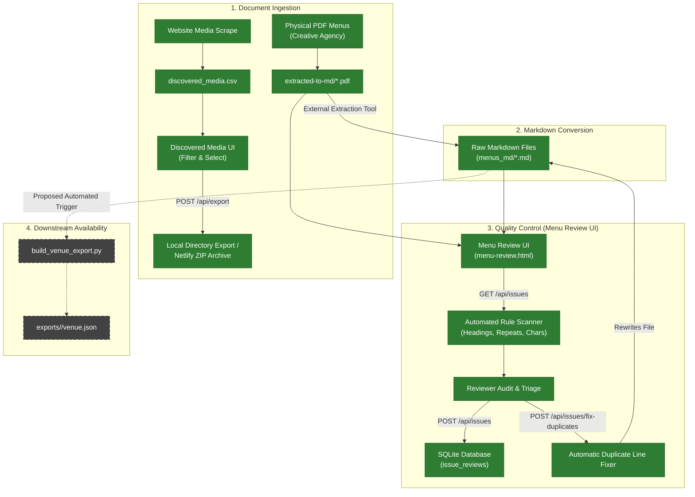
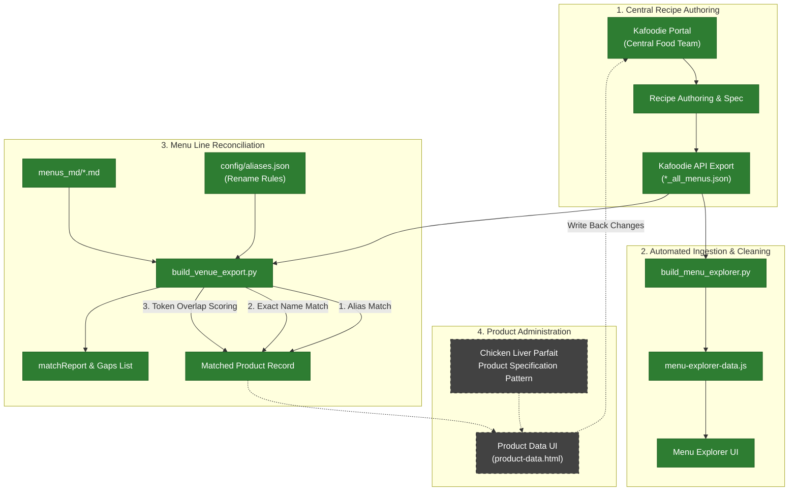
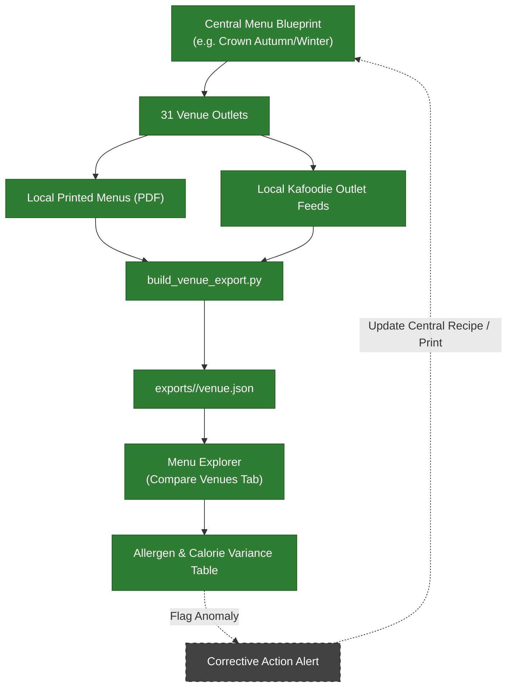
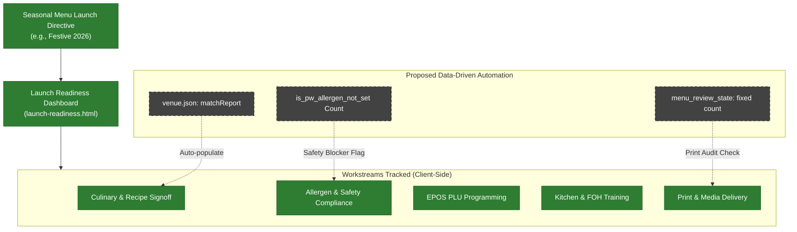

# 04 — Operational Workflow Mapping

## 1. Overview of Hospitality Workflows

This document maps the movement of information, assets, and operational responsibilities across the six primary workflows required to run Food & Beverage operations at The Inn Collection Group.

Each workflow distinguishes between:
* **Solid boxes / arrows**: Currently implemented and code-verified pipelines.
* **Dashed boxes / arrows**: Missing, disconnected, or proposed stages required for full operational maturity.

---

## 2. Workflow Maps

### Workflow A: Menu Document Intake & Quality Control

* **Starting Event**: Marketing uploads a new seasonal menu PDF or updates an existing card.
* **Inputs**: PDF menu files, crawl CSVs.
* **Processing**: PDF inspection, optical/text markdown conversion, issue scanning (`headings`, `repeated_lines`), human review of intentional anomalies.
* **Outputs**: Validated Markdown adhering to `docs/MENU-MD-SPEC.md`.
* **Identified Gaps**: Markdown extraction is performed externally without automated pipeline integration; completion in `menu-review.html` does not automatically trigger rebuilds of `venue.json`.

---

### Workflow B: Product Administration & Recipe Reconciliation

* **Starting Event**: Development Chef updates recipe ingredients, grammages, or allergens in Kafoodie.
* **Inputs**: Kafoodie JSON payloads, Markdown menus, `config/aliases.json`.
* **Processing**: Exact name matching, alias resolution, token similarity scoring, ambiguity checking (runner-up score difference < 0.05).
* **Outputs**: Comprehensive `venue.json` containing linked dish-to-product data.
* **Identified Gaps**: The reconciliation is one-way (read-only from Kafoodie); no administrative interface exists to edit or approve aliases directly in the browser.

---

### Workflow C: Cross-Site Menu Management & Venue Variance

* **Operational Reality**: The same dish (e.g. "Venison Lasagne") served across 20 inns may have varying allergen declarations if one kitchen sources a different cheese or regional supplier.
* **Implemented Capability**: `pages/menu-explorer.html:cmp()` dynamically compares all venues across the entire estate and highlights differences with a single toggle (`Differences only`).
* **Missing Capability**: No automated workflow to notify executive chefs when variance indicates an unapproved local substitution.

---

### Workflow D: Seasonal Launch Readiness Coordination

* **Current Implementation**: A comprehensive prototype in `pages/launch-readiness.html` modeling the operational checklist across 31 properties.
* **Proposed Architecture**: Connecting readiness calculations directly to real data metrics:
  1. A venue's "Recipe Signoff" completes automatically when `dishesMatchedToProduct == dishes` in `venue.json`.
  2. A venue's "Allergen Audit" is blocked if any recipe has `allergenDataMissing == true`.
  3. "Print Collateral" completes when all menu issues in `menu_review_state.sqlite3` are marked `fixed` or `intentional`.
