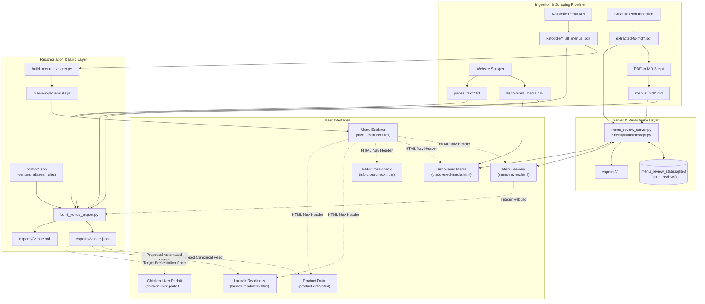

# 05 — Component Relationships

## 1. System Relationship Topology

The Inn Collection Group hospitality workspace currently consists of loosely coupled subsystems. This document categorizes existing verified links, shared dependencies, missing integrations, and architectural consolidation pathways.

---

## 2. Existing Connections [CODE-VERIFIED]

1. **Shared Navigation Bar**:
   * `pages/menu-explorer.html:63` contains a top navigation bar (`<nav class="nav" aria-label="Pages">`) providing direct hyperlinks to `menu-review.html`, `discovered-media.html`, `fnb-crosscheck.html`, `launch-readiness.html`, and `product-data.html`.
2. **Kafoodie to Menu Explorer Pipeline**:
   * `build_menu_explorer.py` aggregates and deduplicates `kafoodie/*_all_menus.json`.
   * Normalizes disparate venue names via `FILTER_NAMES` dictionary.
   * Compiles and outputs `pages/menu-explorer-data.js` as an inlined `window.MENU_DATA` global object.
   * `pages/menu-explorer.html` consumes `window.MENU_DATA` immediately on initialization.
3. **Menu Review and Local Server / Netlify Function**:
   * `pages/menu-review.html` issues standard asynchronous `fetch()` requests against `/api/menus`, `/api/menu?name=...`, `/api/pdf?name=...`, and `/api/issues?name=...`.
   * Both `menu_review_server.py` and `netlify/functions/api.py` implement these endpoints identically.
   * Concurrency is protected via SHA256 header verification (`X-Source-Hash`).
   * Review notes and issue statuses (`open`, `fixed`, `intentional`) write directly to the `issue_reviews` SQLite table.
4. **Discovered Media to Export Endpoints**:
   * `pages/discovered-media.html` parses `discovered_media.csv` client-side.
   * On batch export, issues a JSON `POST /api/export` payload.
   * `menu_review_server.py` creates local nested directories in `exports/<Region>/<Venue>/<Category>/<timestamp>/` and streams down assets via Python's standard `urllib`.
   * `netlify/functions/api.py` packages the selected assets into an in-memory ZIP and returns a Base64-encoded stream.
5. **Venue Export Reconciliation Pipeline**:
   * `build_venue_export.py` merges `menus_md/*.md`, `kafoodie/*_all_menus.json`, `pages_text/*.txt`, `discovered_media.csv`, and `config/*.json`.
   * Evaluates name matching using `config/aliases.json`, exact string matching, and token overlap scoring.
   * Outputs the single most comprehensive, structured data artifact in the entire repository: `exports/<Region>/<Venue>/venue.json`.

---

## 3. Disconnected & Isolated Components [CODE-VERIFIED]

1. **Menu Review to Downstream Pipelines**:
   * When a reviewer fixes duplicate lines via `/api/issues/fix-duplicates` or approves a menu layout, this status is written to SQLite, but **no event or trigger notifies `build_venue_export.py` or `build_menu_explorer.py`**.
   * Corrected Markdown files remain in the review stage until a developer manually runs Python scripts in the terminal.
2. **Product Data & Live Kafoodie Data**:
   * `pages/product-data.html` is an isolated UI prototype containing mock rows. It does not read `venue.json` or `menu-explorer-data.js`.
3. **Launch Readiness Isolation**:
   * `pages/launch-readiness.html` maintains hardcoded in-memory state. It does not pull real metrics from `venue.json` (such as percentage of matched dishes or un-set allergens) nor does it save checklist changes to SQLite.
4. **Chicken Liver Parfait Prototype**:
   * While architecturally rich, `pages/recipes/chicken-liver-parfait-the-lindisfarne-inn.html` is completely hardcoded. No dynamic mechanism exists to render other dishes (e.g. Fish & Chips, Cumberland Sausage) using this layout template.
5. **F&B Role Cross-check**:
   * Completely static evaluation dashboard; not connected to issue trackers or live codebase status registers.

---

## 4. Shared Dependencies & Redundancy

* **Duplicate Markdown Directories**:
  * Extracted menu markdown files exist in two separate locations: `inncollectiongroup.com_root/menus_md/` and `pages/menus_md/`.
  * `menu_review_server.py` reads from `inncollectiongroup.com_root/menus_md/`, whereas `netlify/functions/api.py` falls back through candidate paths (`/tmp/menus_md`, `pages/menus_md`, `inncollectiongroup.com_root/menus_md`).
* **Venue Name Discrepancies**:
  * The Kafoodie API uses names like "The Black Swan Inn", "The Midland Hotel", and "The Stables At Cross Butts".
  * The marketing PDF menus use "The Black Swan", "The Midland", and "The Stables, Whitby".
  * Reconciled in code via `build_menu_explorer.py:FILTER_NAMES` and `config/aliases.json`.
