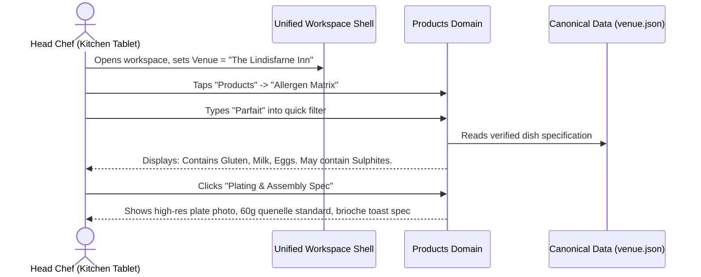
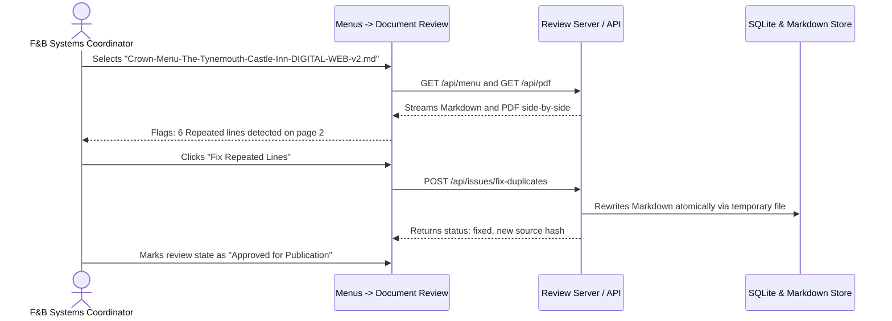

# 06 — Workspace Consolidation Proposal

## 1. Executive Proposal: The 5-Domain Workspace

Rather than preserving seven disconnected standalone pages, the system should evolve into a unified, coherent **Hospitality Technology Capability Workspace**. 

We recommend consolidating the interfaces into five logical operational domains organized around the natural workflows of multi-site F&B management:

```mermaid
flowchart TD
    subgraph Navigation["Unified Global Shell & Navigation"]
        TOP["Inn Collection Group — Hospitality Technology Workspace"]
    end

    TOP --> D1["1. PRODUCTS<br/>(Culinary & Safety Specs)"]
    TOP --> D2["2. MENUS<br/>(Documents, Review & Explorer)"]
    TOP --> D3["3. OPERATIONS<br/>(Kitchen, Prep & Suppliers)"]
    TOP --> D4["4. LAUNCHES<br/>(Seasonal Readiness & Rollouts)"]
    TOP --> D5["5. INTELLIGENCE<br/>(Auditing, Gaps & Variance)"]

    subgraph Domain1["1. Products"]
        D1 --> P1["Master Catalog (from Product Data)"]
        D1 --> P2["Dish Spec View (from Chicken Liver Parfait template)"]
        D1 --> P3["Allergen & Nutrition Registry"]
    end

    subgraph Domain2["2. Menus"]
        D2 --> M1["Document Ingestion & Media (from Discovered Media)"]
        D2 --> M2["PDF/Markdown Review (from Menu Review)"]
        D2 --> M3["Live Menu & Guest Explorer (from Menu Explorer)"]
    end

    subgraph Domain3["3. Operations"]
        D3 --> O1["Site Prep Sheets & Portion Guides"]
        D3 --> O2["Supplier Directory & Order Schedule"]
        D3 --> O3["Plating Standards & SOP Library"]
    end

    subgraph Domain4["4. Launches"]
        D4 --> L1["Multi-Site Rollout Matrix (from Launch Readiness)"]
        D4 --> L2["Milestone & Checklist Tracker"]
        D4 --> L3["EPOS & Print Dispatch Verification"]
    end

    subgraph Domain5["5. Intelligence"]
        D5 --> I1["Cross-Venue Variance Engine (from Explorer Compare)"]
        D5 --> I2["System Capability Gap Analysis (from F&B Crosscheck)"]
        D5 --> I3["Unmatched Dish Triage (from matchReport)"]
    end
```

---

## 2. Consolidation Mapping Matrix

| Proposed Domain | Sub-View / Tab | Source Interfaces Replaced | Architectural Change |
| :--- | :--- | :--- | :--- |
| **1. Products** | Master Product Catalog | `pages/product-data.html` | Transition from static mockups to dynamically rendering `venue.json:products[]`. |
| | Dish Spec Sheet | `pages/recipes/chicken-liver-parfait...html` | Turn the hardcoded Parfait layout into a generic, parameter-driven template for any recipe ID. |
| | Allergen & Nutrition Engine | `pages/menu-explorer.html` (Allergen tabs) | Centralize the 14-allergen matrix and per-serving/per-100g nutrition calculations. |
| **2. Menus** | Menu Explorer & Guest View | `pages/menu-explorer.html` (Menu, Guest views) | Retained as the central interactive menu viewing engine. |
| | Document Review & QC | `pages/menu-review.html` | Integrated as the administrative editing and quality control view for menu documents. |
| | Media & Collateral Intake | `pages/discovered-media.html` | Converted into a media repository tab within the Menus domain. |
| **3. Operations** | Kitchen SOPs & Prep | Chicken Liver Parfait (Prep tabs) | Provides daily kitchen prep schedules and portion yield calculators. |
| | Supplier & Order Guides | Chicken Liver Parfait (Supplier tabs) | Surfaces Brakes codes, minimum order quantities, and delivery cutoffs. |
| **4. Launches** | Launch Readiness Matrix | `pages/launch-readiness.html` | Connect checklist completion to live SQLite reviews and `matchReport` coverage. |
| **5. Intelligence** | Cross-Venue Comparison | `pages/menu-explorer.html` (Compare tab) | Retained for highlighting cross-site recipe and calorie divergence. |
| | Gap & Capability Audit | `pages/fnb-crosscheck.html` | Embedded as a diagnostic panel showing roadmap coverage and operational manual dependencies. |
| | Alias Resolution Studio | `build_venue_export.py:matchReport` | Web UI for triaging unmatched dishes and updating `config/aliases.json` with a single click. |

---

## 3. Alternative Architecture Considered: Venue-Centric Model

An alternative architecture was evaluated: organizing the workspace primarily around **Individual Venues** rather than functional domains (e.g., selecting "The Lindisfarne Inn" first, and viewing tabs for its Menus, Products, Kitchen, and Launch status).

* **Pros**: Natural mental model for General Managers and Head Chefs focused entirely on their own property.
* **Cons**: Severely impedes central F&B management, group executive chefs, and compliance directors who need cross-site visibility (e.g. "Show me every inn serving Venison Lasagne where nuts are declared as may-contain").
* **Recommended Decision**: Adopt the **5-Domain Functional Workspace** with a persistent global **Venue Selector & Filter** accessible across all domains. This gives both central teams estate-wide views and site managers single-property focus.

---

## 4. End-to-End User Journeys

### Journey 1: Head Chef Verifying Allergen Specs During Service

### Journey 2: F&B Coordinator Auditing a New Seasonal Menu

---

## 5. Shared Core Infrastructure

To support this consolidated workspace, four shared services must be implemented across all views:
1. **Canonical Venue Data Cache**: A shared service loading `exports/<Venue>/venue.json` on demand, eliminating disjoint JSON shapes across tools.
2. **Standardized Status Indicators**: Consistent visual badge standards across the entire platform:
   * Green: Verified / Compliant / Fixed / Match Score 1.0.
   * Amber: May Contain / Partial Match / Token Ambiguity / Open Review.
   * Red: Un-set Allergen (`is_pw_allergen_not_set`) / Unmatched Dish / Safety Blocker.
3. **Common Keyboard Navigation**: Quick search palette (`Cmd+K` / `Ctrl+K`) for jumping instantly between dishes, menus, and venues.
