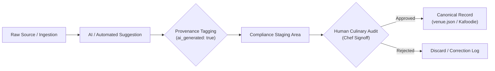

# 08 — AI & Automation Opportunities

## 1. Guiding Principle: AI as Advisory, Never Silently Authoritative

In hospitality technology, and particularly in Food & Beverage operations, **accuracy around allergens, food safety, and statutory compliance is life-critical**. 

A fundamental rule governs all proposed intelligence layers:
> **AI models and automated heuristics must never silently create or alter authoritative operational records.** 
> All AI-generated outputs (extracted Markdown, suggested dish-to-recipe aliases, draft kitchen specs, or dietary tags) must be clearly badged with provenance and require explicit human verification by culinary authority before publication.

---

## 2. Evaluation Matrix: Deterministic Automation vs. AI Assistance

Where deterministic code can achieve 100% predictable accuracy with zero hallucination risk, software engineering must be preferred over generative AI.

| Capability | Best Approach | Rationale | Risk Level |
| :--- | :--- | :--- | :--- |
| **PDF Extraction to Markdown** | **Hybrid (AI + Deterministic)** | Layout variance across printed menus makes rigid regex brittle; multimodal LLMs excel at tabular visual parsing. | Medium (Prices/text may hallucinate without validation) |
| **Dish-to-Recipe Alias Suggestions** | **AI (Semantic Similarity)** | Discovers non-obvious culinary synonyms (e.g., "Northumbrian Game" -> "Pie Of The Week - Northumbrian Game"). | Low (Suggestions require human signoff in `aliases.json`) |
| **Allergen Matrix & Cross-Contact** | **Deterministic Rules Engine** | Allergen matching must follow strict Boolean logic from recipe ingredients; zero tolerance for stochastic error. | Critical (Must be 100% deterministic) |
| **Cross-Venue Variance Detection** | **Deterministic Code** | Comparing string tokens, calorie counts, and allergen flags across venues is an exact relational operation. | Low (Already implemented in Menu Explorer) |
| **Staff Training & Plating Guides** | **AI Generative Assistance** | Generates narrative SOP descriptions, front-of-house tasting notes, and wine pairing suggestions from dish specs. | Low (Educational and descriptive) |

---

## 3. High-Value AI & Automation Opportunities

### Opportunity 1: Automated PDF Menu Ingestion & Markdown Drafting
* **Current State**: Menu PDFs are extracted to Markdown via an external, manual process.
* **Proposed AI System**:
  * **Input**: Unstructured PDF menus uploaded to `inncollectiongroup.com_root/documents/extracted-to-md/`.
  * **Processing**: Multimodal Document LLM parses pages, identifying dish titles, prices, dietary codes (`V`, `VG`, `GFA`), crown recommendations (`♛`), and column headers (`<!-- cols: ... -->`).
  * **Output**: Formatted Markdown adhering strictly to `docs/MENU-MD-SPEC.md`.
  * **Human Verification Gate**: The drafted Markdown is automatically staged in `pages/menu-review.html` with an `AI-Draft` status. A human reviewer audits against the rendered PDF before marking `Approved`.

### Opportunity 2: Intelligent Alias Suggestion for Unmatched Dishes
* **Current State**: `build_venue_export.py:matchReport` logs unmatched dishes to `unmatchedDishes[]`. A developer must manually inspect Kafoodie recipe lists and update `config/aliases.json`.
* **Proposed System**:
  * **Input**: Unmatched printed dish name (e.g., "Homemade Chicken Kiev") + catalog of unmatched Kafoodie recipes for that venue.
  * **Processing**: Vector embeddings / LLM semantic similarity ranks the top 3 candidate recipes.
  * **Output**: A proposed alias entry (e.g. `"homemade chicken kiev": "Chicken Kiev"`).
  * **Human Verification Gate**: A web interface in the workspace presents the suggestion with a one-click "Accept Alias" button that writes directly to `config/aliases.json` and triggers reconciliation.

### Opportunity 3: Natural Language Operational Assistant ("Ask the Estate")
* **Current State**: Central teams must manually filter tables or inspect raw JSON to answer operational questions.
* **Proposed System**:
  * **Input**: Plain-language query from an Executive Chef or Area Manager (e.g., *"Which inns in Cumbria are serving a Sunday roast with no gluten-containing ingredients?"* or *"What is our average gross profit margin across starters in Yorkshire?"*).
  * **Processing**: RAG (Retrieval-Augmented Generation) operating over canonical `venue.json` files and Kafoodie nutritional tables.
  * **Output**: Accurate, cited answer linking directly to the specific venue menu lines.

### Opportunity 4: Automated Kitchen Spec Generation (The "Parfait" Factory)
* **Current State**: The Chicken Liver Parfait page (`pages/recipes/chicken-liver-parfait-the-lindisfarne-inn.html`) is a one-off, handcrafted masterwork of culinary presentation.
* **Proposed System**:
  * **Input**: Raw recipe JSON from Kafoodie + supplier price lists from Brakes/local vendors.
  * **Processing**: AI template engine drafts prep instructions, assembly step summaries, holding temperatures, and FOH service highlights.
  * **Output**: Dynamically generated interactive dish spec pages matching the Chicken Liver Parfait aesthetic for all 200+ core dishes in the ICG catalog.
  * **Human Verification Gate**: The Executive Chef reviews and certifies the digital recipe card before distribution to kitchen display screens.

---

## 4. Safety Guardrails & Compliance Architecture

To maintain food safety integrity, the workspace must enforce the following architectural constraints:

1. **Immutable Provenance Logs**: Every record generated or modified with AI assistance must include metadata: `generator_model`, `prompt_hash`, `timestamp`, and `certified_by_user_id`.
2. **Deterministic Fallbacks**: If an AI service is unavailable or confidence scores drop below 0.85, the system must degrade gracefully to deterministic token matching or explicit manual entry.
3. **No Unassisted Publication**: Guest-facing allergen matrices and EPOS price lists must require explicit, authenticated human approval prior to cache invalidation and publication.
