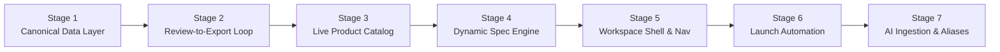

# 10 — Next Stage Recommendations & Roadmap

## 1. Architectural Strategy: Data Foundation Before UI Redesign

A critical finding of this discovery exercise is that **the project already possesses an exceptionally capable reconciliation engine (`build_venue_export.py`) and a rich data schema (`venue.json`)**, but several frontend interfaces (`product-data.html`, `launch-readiness.html`, and `chicken-liver-parfait...html`) are currently running on mock or hardcoded data.

Therefore, the next development phase must **not** begin with premature visual restyling or framework rewrites. 

Instead, the next stage must focus on **connecting the existing pipelines to form a closed, self-sustaining operational feedback loop**:



---

## 2. Staged Implementation Plan

### Stage 1: Establish `venue.json` as the Estate-Wide Canonical Data Layer
* **Objective**: Generate and validate canonical data across all 31 venues.
* **Prerequisites**: None. Tooling already exists in `build_venue_export.py`.
* **Actions**:
  1. Execute `python3 build_venue_export.py --all` to compile standardized JSON exports for every property into `exports/<Region>/<Venue>/venue.json`.
  2. Resolve the two missing Kafoodie venues (`Dean Court` and `The Bull's Head Inn`) by either acquiring their Kafoodie outlet IDs or introducing a placeholder configuration.
  3. Resolve directory duplication: eliminate the divergence between `inncollectiongroup.com_root/menus_md/` and `pages/menus_md/` by establishing a single canonical folder.
* **Effort**: Low (1–2 days).
* **What It Enables**: Gives every downstream interface a complete, validated data foundation.

---

### Stage 2: Connect Menu Review Quality Control to the Build Pipeline
* **Objective**: Close the loop between menu document corrections and downstream data availability.
* **Prerequisites**: Stage 1.
* **Actions**:
  1. In `menu_review_server.py` and `netlify/functions/api.py`, add a POST endpoint (`/api/menus/rebuild`) that triggers `build_venue_export.py` for the affected venue once all issues are marked `fixed` or `intentional`.
  2. In `pages/menu-review.html`, add an active status banner: *"All issues resolved for this menu — Rebuild Venue Export"*.
  3. Surface the `matchReport` gap list (unmatched dishes and ambiguity warnings) directly in the review UI so coordinators can see immediately when an OCR typo caused a matching failure.
* **Effort**: Medium (3–4 days).
* **What It Enables**: Eliminates manual terminal intervention; review edits flow directly into production data.

---

### Stage 3: Wire the Product Data Interface to Real Venue Data
* **Objective**: Replace the static mockup in `pages/product-data.html` with real, queryable product records.
* **Prerequisites**: Stage 1.
* **Actions**:
  1. Refactor `pages/product-data.html` to load from `exports/<Venue>/venue.json` or a consolidated estate index.
  2. Populate the table with real Kafoodie recipe IDs, printed menu item titles, prices, allergen declarations, and calorie counts.
  3. Add a visual compliance indicator for dishes where `allergenDataMissing == true` (`is_pw_allergen_not_set`), allowing F&B directors to filter by "Compliance Blockers".
* **Effort**: Medium (3–5 days).
* **What It Enables**: Provides central F&B management with an immediate, live operational catalog.

---

### Stage 4: Parameterize the Dish Spec Engine ("Parfait Factory")
* **Objective**: Turn the rich Chicken Liver Parfait presentation layout into a reusable template for any dish in the estate.
* **Prerequisites**: Stages 1 & 3.
* **Actions**:
  1. Extract the HTML/CSS structure of `pages/recipes/chicken-liver-parfait-the-lindisfarne-inn.html` into a dynamic template (`dish-spec.html?venue=lindisfarne&id=5323684`).
  2. Bind the hub-and-spoke modal sheets (Ingredients, Plating Standards, Allergens, Costing, Nutrition) to fields from `venue.json:products[]`.
  3. Enable kitchen teams to bookmark and pull up high-fidelity digital spec sheets on kitchen tablets for any dish on their current menu.
* **Effort**: Medium–High (5–7 days).
* **What It Enables**: Transforms a one-off demonstration into an estate-wide digital kitchen operating standard.

---

### Stage 5: Unify Navigation & Global Workspace Shell
* **Objective**: Implement the consolidated 5-domain workspace proposed in `06_WORKSPACE_PROPOSAL.md`.
* **Prerequisites**: Stages 1–4.
* **Actions**:
  1. Implement a persistent global header across all pages with domain tabs (`Products`, `Menus`, `Operations`, `Launches`, `Intelligence`) and a universal **Venue Selector**.
  2. Embed quick-action keyboard shortcuts (`Cmd+K` palette for instant dish/menu search).
  3. Ensure seamless cross-linking (e.g. clicking a dish in Menu Explorer opens its full Spec Sheet in Products; clicking an unmatched dish opens the Alias Studio in Intelligence).
* **Effort**: Medium (4–6 days).
* **What It Enables**: A seamless, modern desktop and tablet workspace that eliminates fragmented page jumping.

---

### Stage 6: Automate Launch Readiness with Real Pipeline Telemetry
* **Objective**: Turn `pages/launch-readiness.html` into an automated, data-driven coordination engine.
* **Prerequisites**: Stages 1–5.
* **Actions**:
  1. Replace hardcoded checklist numbers with real mathematical calculations derived from `venue.json`:
     * *Recipe Completeness*: % of printed dishes matched to a verified Kafoodie recipe (`dishesMatchedToProduct / dishes`).
     * *Food Safety Compliance*: % of dishes with verified allergens (`100% - (is_pw_allergen_not_set count)`).
     * *Print QC Status*: % of menu files with zero open review issues in SQLite.
  2. Add persistence for operational signoffs so General Managers can check off site-level briefing tasks and save state to the database.
* **Effort**: Medium (4–5 days).
* **What It Enables**: Real-time estate rollout visibility for seasonal menu launches.

---

### Stage 7: Introduce Selective AI & Ingestion Automation
* **Objective**: Reduce clerical overhead in PDF extraction and dish alias authoring.
* **Prerequisites**: Stages 1–6 (A verified human review workflow must exist before introducing AI).
* **Actions**:
  1. Build an AI-assisted PDF menu extractor that reads newly uploaded PDF menus and drafts `MENU-MD-SPEC.md` Markdown directly into the `menu-review.html` staging queue.
  2. Implement an **Alias Suggestion Studio**: when `build_venue_export.py` encounters an unmatched dish, use semantic embeddings to suggest the top 3 Kafoodie recipe candidates, allowing coordinators to accept with one click and update `config/aliases.json`.
* **Effort**: High (7–10 days).
* **What It Enables**: Dramatically accelerates seasonal onboarding while preserving strict human oversight on food safety.

---

## 3. Summary Roadmap & Milestone Timeline

```
Week 1: Data Foundations & Review Loop Closure
├── Compile venue.json for all 31 properties (Stage 1)
├── Connect menu review approval to automated venue rebuilding (Stage 2)
└── Eliminate duplicate menus_md directories

Week 2: Operational Catalog & Dynamic Spec Engine
├── Wire Product Data UI to live venue.json feeds (Stage 3)
└── Extract Chicken Liver Parfait template for estate-wide dish specs (Stage 4)

Week 3: Workspace Shell & Launch Automation
├── Build unified 5-domain navigation shell with global venue selector (Stage 5)
└── Wire Launch Readiness checklists to real pipeline metrics (Stage 6)

Week 4+: Intelligence & AI Automation
├── Build Alias Suggestion Studio for unmatched dishes (Stage 7)
└── Prototype Multimodal PDF menu extraction pipeline (Stage 7)
```
