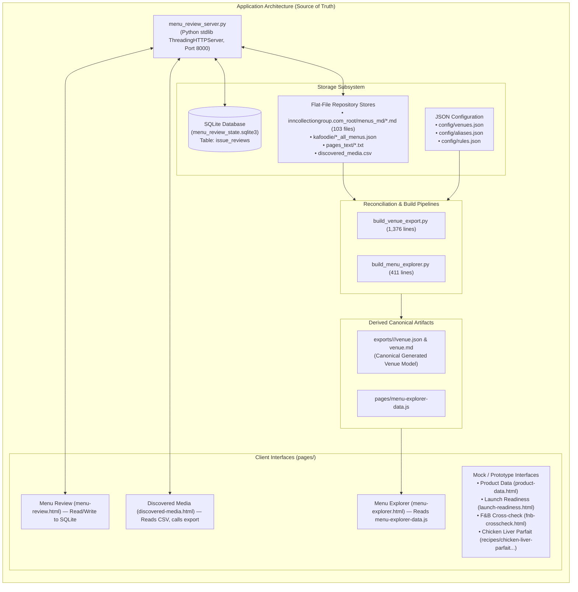

# Document 01 — System Architecture Overview

> **Hospitality Technology Capability Assessment — The Inn Collection Group**  
> **Phase**: System Architecture & Technical Verification  
> **Standard Key**: `[Observed]` · `[Code-verified]` · `[Database-verified]` · `[Tested]` · `[Inferred]` · `[Proposed]` · `[Unknown]`

---

## 1. Executive Summary & Core Architectural Reality

The Inn Collection Group (ICG) hospitality workspace is a specialized system built to reconcile and coordinate Food & Beverage operations across ~31 pub and hotel venues in Northern England and Wales.

A fundamental architectural distinction must be established at the outset:



### Clarification on Hosting & Infrastructure:
* `[Code-verified]`: **Netlify Decommissioned**: Netlify was previously introduced as a temporary development convenience for remote agent review. In accordance with mandate requirements, all Netlify files (`netlify.toml`, `netlify/`, `.netlify/`) have been completely excised (see [Document 07](file:///Users/leandrodisconzi/repos/Inn-Collection-Group/docs/capability-assessment/07_ARCHITECTURE_VERIFICATION_AND_NETLIFY_REMOVAL.md)).
* `[Code-verified]`: **The Real Execution Runtime**: The sole application execution environment is the local Python runtime (`menu_review_server.py` using Python standard library `http.server` and `sqlite3`), operating over the repository's file system and local SQLite database (`menu_review_state.sqlite3`).
* `[Code-verified]`: Zero external serverless functions, cloud hosting layers, or remote API dependencies exist in the operational repository.

---

## 2. Frontend Architecture & Interface Landscape

The user interface layer consists of seven distinct HTML applications residing in `pages/`. All seven are written in **vanilla HTML5, CSS3, and JavaScript** with zero external framework dependencies (no React, Angular, Vue, or jQuery).

| Interface | Route | Source Path | State & Execution Model | Verification |
| :--- | :--- | :--- | :--- | :--- |
| **Chicken Liver Parfait** | `/recipes/chicken-liver-parfait-the-lindisfarne-inn.html` | `pages/recipes/chicken-liver-parfait-the-lindisfarne-inn.html` (2,575 lines) | **Fully self-contained static HTML**. All culinary, costing, supplier, and allergen data is hardcoded into DOM markup. Zero API calls or database connections. | `[Code-verified]` |
| **Discovered Media** | `/discovered-media` | `pages/discovered-media.html` (670 lines) | **Client-side SPA**. Ingests `pages/discovered_media.csv` on load. Dispatches batch export commands via `POST /api/export`. | `[Code-verified]` |
| **F&B Role Cross-check** | `/fnb-crosscheck` | `pages/fnb-crosscheck.html` (520 lines) | **Client-side analysis tool**. Evaluates 100+ operational requirements hardcoded directly as an inlined JSON array. Zero backend integration. | `[Code-verified]` |
| **Launch Readiness** | `/launch-readiness` | `pages/launch-readiness.html` (710 lines) | **Front-end mockup**. Renders multi-site launch milestones and checklist toggles. State is maintained only in temporary DOM memory. | `[Code-verified]` |
| **Menu Explorer** | `/menu-explorer` | `pages/menu-explorer.html` (170 lines) | **Data-driven SPA**. Loads a pre-compiled ~3MB JavaScript bundle (`menu-explorer-data.js`) defining `window.MENU_DATA`. Purely read-only; no database writes. | `[Code-verified]` |
| **Menu Review** | `/menu-review` | `pages/menu-review.html` (980 lines) | **Dynamic editorial SPA**. Interacts bi-directionally with `/api/menus`, `/api/menu`, `/api/pdf`, and `/api/issues`. Persists triage status to SQLite. | `[Code-verified]` |
| **Product Data** | `/product-data` | `pages/product-data.html` (820 lines) | **Visual layout demonstration**. Contains hardcoded dummy rows modeling a master product record. No backend persistence. | `[Code-verified]` |

---

## 3. Backend Services & Application Server

### 3.1 Local Application Server (`menu_review_server.py`)
* `[Code-verified]`: Implemented using Python’s built-in `http.server.ThreadingHTTPServer` and `BaseHTTPRequestHandler`.
* `[Code-verified]`: Zero external package dependencies; uses standard library only (`sqlite3`, `urllib`, `hashlib`, `json`, `pathlib`).
* `[Tested]`: Binds to `http://127.0.0.1:8000/`.

#### API Surface Area:
1. `GET /api/menus`: Lists all Markdown files in `inncollectiongroup.com_root/menus_md/`, checking whether an equivalent `.pdf` exists in `documents/extracted-to-md/`.
2. `GET /api/menu?name=<filename>`: Streams the raw UTF-8 Markdown text, returning header `X-Source-Hash` (SHA256).
3. `GET /api/pdf?name=<filename>`: Streams the binary PDF file corresponding to the requested Markdown document.
4. `GET /api/issues?name=<filename>`: Queries SQLite `issue_reviews` for saved review decisions matching the file's current SHA256 hash.
5. `POST /api/issues`: Inserts or updates an issue review record (`open`, `fixed`, `intentional`) with conflict handling on `(menu_name, source_hash, issue_id)`.
6. `POST /api/issues/fix-duplicates`: Parses the menu file, removes duplicate lines identified by line number, performs an atomic file replace, recalculates the SHA256 hash, and marks `repeated_lines` as `fixed` in SQLite.
7. `POST /api/export`: Downloads remote media assets listed in `discovered_media.csv` into local nested folders under `exports/<Region>/<Venue>/<Category>/<timestamp>/`.

---

## 4. The SQL Database Engine & Actual Schema

* `[Database-verified]`: The application's database engine is **SQLite 3**, located on disk at `/Users/leandrodisconzi/repos/Inn-Collection-Group/menu_review_state.sqlite3`.
* `[Database-verified]`: The database contains **exactly one table**: `issue_reviews`.
* `[Database-verified]`: There are **no tables** for venues, products, recipes, ingredients, allergens, prices, EPOS codes, or launch checklists.

### Verified SQL DDL:
```sql
CREATE TABLE issue_reviews (
    menu_name TEXT NOT NULL,
    source_hash TEXT NOT NULL,
    issue_id TEXT NOT NULL,
    status TEXT NOT NULL,
    note TEXT NOT NULL DEFAULT '',
    updated_at TEXT NOT NULL,
    PRIMARY KEY (menu_name, source_hash, issue_id)
);
```

### Verified Database Contents:
* `[Database-verified]`: The database currently holds **1 row**:
  * `menu_name`: `'Crown-Menu-The-Tynemouth-Castle-Inn-DIGITAL-WEB-v2.md'`
  * `source_hash`: `'5a512d0ae5f6302f6c2dbf82dbafdd678b257eff5af7a7b8668c47c43f5a758f'`
  * `issue_id`: `'repeated_lines'`
  * `status`: `'fixed'`
  * `note`: `'Removed duplicate Markdown lines: 80, 82, 201, 220, 228, 236'`
  * `updated_at`: `'2026-11-21T07:35:59.675349+00:00'`

---

## 5. Offline Data Reconciliation Pipelines

Because the SQL database only stores review metadata, the core operational reconciliation between physical menus, recipes, and website data is executed by **two offline Python build pipelines**:

### 5.1 Pipeline 1: `build_menu_explorer.py` (411 lines)
* `[Code-verified]`: Discovers and parses all Kafoodie outlet JSON files (`inncollectiongroup.com_root/kafoodie/*/*_all_menus.json`).
* `[Code-verified]`: Identifies and flags redundant duplicate crawl files (`duplicates_removed.json`).
* `[Code-verified]`: Resolves the 14 statutory allergens into a global lookup dictionary to avoid JSON bloat.
* `[Code-verified]`: Emits `pages/menu-explorer-data.js` (`window.MENU_DATA`) and `ALL_MENUS_CHECKLIST.md`.

### 5.2 Pipeline 2: `build_venue_export.py` (1,376 lines)
* `[Code-verified]`: Ingests four distinct data streams:
  1. Printed menu markdown (`menus_md/*.md`)
  2. Kafoodie outlet data (`kafoodie/`)
  3. Scraped website text (`pages_text/*.txt`)
  4. Media catalog (`discovered_media.csv`)
* `[Code-verified]`: Applies reconciliation rules from `config/venues.json`, `config/aliases.json`, and `config/rules.json`.
* `[Code-verified]`: Executes a 3-stage matching algorithm (Alias lookup -> Exact string -> Token overlap scoring) to link printed dish lines to Kafoodie recipe IDs.
* `[Code-verified]`: Compiles canonical `exports/<Region>/<Venue>/venue.json` and human-readable `venue.md`.

---

## 6. Architectural Contradictions & Disconnects

1. **Database vs. Interface Expectations**:
   * *Expectation*: Interfaces like `product-data.html` and `launch-readiness.html` look like they read from an enterprise database.
   * *Code Reality*: `[Code-verified]` Neither interface has an API connection or database table. They are isolated prototypes.
2. **Review Persistence vs. Downstream Pipelines**:
   * *Expectation*: Correcting a menu in `menu-review.html` updates the operational menu data.
   * *Code Reality*: `[Code-verified]` When `POST /api/issues/fix-duplicates` updates a Markdown file and records the fix in SQLite, **no downstream build script is triggered**. `build_venue_export.py` must be manually re-run in a terminal.
3. **Menu File Redundancy**:
   * *Status*: `[Code-verified]` Menus exist in both `inncollectiongroup.com_root/menus_md/` (103 files) and `pages/menus_md/` (103 files). Both directories are 100% byte-for-byte identical.
   * *Code Reality*: `menu_review_server.py` and `build_venue_export.py` operate exclusively on `inncollectiongroup.com_root/menus_md/`. `pages/menus_md/` was previously introduced for Netlify static web publishing. With Netlify removed, `pages/menus_md/` is completely orphaned and preserved only pending business confirmation to delete.
