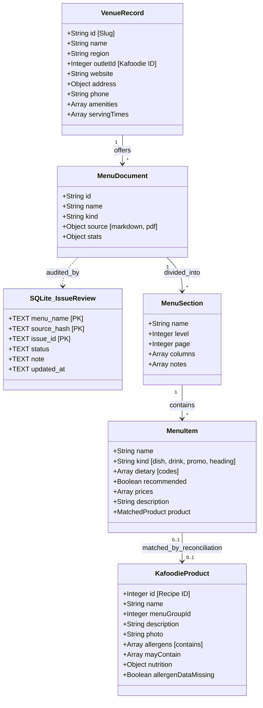

# Document 02 — Data Model and Entity Relationships

> **Hospitality Technology Capability Assessment — The Inn Collection Group**  
> **Phase**: System Architecture & Technical Verification  
> **Standard Key**: `[Observed]` · `[Code-verified]` · `[Database-verified]` · `[Tested]` · `[Inferred]` · `[Proposed]` · `[Unknown]`

---

## 1. Executive Summary: Relational Reality vs. Conceptual Model

A central discovery of this investigation is that **the relational data model does not reside in a multi-table SQL database**.

Instead, the system’s data architecture is partitioned across three storage layers:
1. **The SQL Layer (SQLite `menu_review_state.sqlite3`)**: Exclusively holds document-review and quality-control flags (`Database-verified`).
2. **The File-Based Master Schema (`venue.json`)**: Generated by `build_venue_export.py`, this is the true canonical data model of the application (`Code-verified`).
3. **The Upstream Ingestion Feeds**: Raw Kafoodie JSON crawls, Markdown menu files, website scrape text, and media CSVs (`Code-verified`).

---

## 2. The Five Key Hospitality Entities: Code Reality

The mandate requires establishing whether the system actually distinguishes between five critical concepts:

| Entity Level | Conceptual Meaning | Actual System Implementation | Status & Code Evidence |
| :--- | :--- | :--- | :--- |
| **1. Product** | A centralized commercial product sold across the business with a master SKU, costing, and specification. | **Partially Implemented**. In `build_venue_export.py:551-584`, products are extracted from Kafoodie as `products[]`. However, they lack SKUs and cost prices. `pages/product-data.html` models this conceptually with dummy data. | `[Code-verified]` in pipeline; `[Observed]` mockup in UI. |
| **2. Recipe** | Culinary preparation SOP, ingredient weights, yields, and kitchen cooking instructions. | **Partially Implemented**. In Kafoodie JSONs, a "recipe" is a flat entity with allergens and calories. Detailed culinary prep exists **only** in the hardcoded `pages/recipes/chicken-liver-parfait...html`. | `[Code-verified]` flat data; `[Observed]` rich prep on 1 dish. |
| **3. Ingredient** | Raw purchased components from suppliers (e.g. butter, chicken livers, cream, shallots). | **Partially Implemented**. Present as a raw text string `ingredients_simple` in Kafoodie (`build_venue_export.py:578`). Granular supplier codes exist only in the hardcoded Parfait demo. | `[Code-verified]` text; `[Observed]` supplier codes on 1 dish. |
| **4. Menu Item** | A printed line on a physical menu card (name, printed price, printed dietary abbreviations, printed description). | **Fully Implemented**. Extracted from PDF-Markdown into `menus[].sections[].items[]` by `build_venue_export.py:337-384` adhering strictly to `docs/MENU-MD-SPEC.md`. | `[Code-verified]`. |
| **5. Venue Offering** | The binding of a Menu Item to a specific Venue at a specific price, matched to a central Product. | **Fully Implemented**. Generated in `exports/<Region>/<Venue>/venue.json`, linking the local printed item to central Kafoodie product ID with a match score. | `[Code-verified]`. |

---

## 3. Comprehensive Entity Register

### 3.1 Spatial & Organizational Entities
* **Region**:
  * *Code Reality*: `[Code-verified]`. Implemented as strings (`County Durham`, `Northumberland`, `Lancashire`, `Lake District`, `Yorkshire`, `Tyne and Wear`, `North Wales`). Managed via `config/venues.json` overrides or discovered via `accommodation_*.txt` scraping patterns in `build_venue_export.py:228-246`.
  * *Database Reality*: `[Database-verified]`. **No SQL table exists**.
* **Venue / Site**:
  * *Code Reality*: `[Code-verified]`. Identified by slugified ID (e.g. `the-kingslodge-inn`) and Kafoodie `outletId` (integer, e.g. `15900`). The `outletId` is the reliable join key across the system.
  * *Database Reality*: `[Database-verified]`. **No SQL table exists**.

### 3.2 Menu & Document Entities
* **Menu Document**:
  * *Code Reality*: `[Code-verified]`. Stored as Markdown files matching `docs/MENU-MD-SPEC.md`. Contains HTML comments for metadata (`<!-- page: 2 -->`, `<!-- cols: Bottle | 250ml | 175ml -->`, `<!-- source: file.pdf -->`).
  * *Database Reality*: `[Database-verified]`. Referenced in SQLite `issue_reviews.menu_name` to store quality audit decisions.
* **Menu Section**:
  * *Code Reality*: `[Code-verified]`. Represents heading levels (`## LIGHT BITES`, `### Desserts`). Contains column headers and section-level service notes (e.g. *"Served 11am - 5pm"*).
* **Menu Item**:
  * *Code Reality*: `[Code-verified]`. Represents printed lines:
    * `name`: string (e.g. `"Classic Prawn Sandwich"`).
    * `kind`: classified by `build_venue_export.py:607-623` as `dish`, `drink`, `promo`, `heading`, or `grouping`.
    * `dietary`: array of codes printed on paper (`["V", "GFA"]`).
    * `recommended`: boolean (`true` if crown symbol ♛ is present).
    * `prices`: array of objects `{raw: "8.50", amount: 8.5, label: null}`.
    * `product`: foreign key link `{id: 5323684, name: "Prawn Marie Rose Sandwich", matchScore: 1.0, via: "alias"}`.

### 3.3 Culinary & Safety Entities
* **Product / Recipe**:
  * *Code Reality*: `[Code-verified]`. Extracted from Kafoodie API payloads into `products[]` in `venue.json`. Contains:
    * `id`: Kafoodie numeric recipe ID (e.g. `2010587`).
    * `name`: string (e.g. `"Full Breakfast"`).
    * `menuGroup`: string (e.g. `"Breakfast"`).
    * `photo`: URL to hosted image on `kitchen.kafoodle.com`.
    * `allergens`: array of objects `{id, name, label, abbr, primaryId}` for "contains".
    * `mayContain`: array of objects for "may contain".
    * `nutrition`: object `{basis: "per serving", nutrients: {energy, fat, salt...}}`.
    * `allergenDataMissing`: boolean (`is_pw_allergen_not_set`).
* **Allergen Reference Taxonomy**:
  * *Code Reality*: `[Code-verified]`. 14 statutory allergens defined in `build_menu_explorer.py` and `build_venue_export.py:586-602`. Sub-allergens (e.g., `Gluten: Wheat`, `Gluten: Barley`) reference their parent via `primaryId`.

### 3.4 Missing, Unrepresented, or Mocked Entities
1. **Product Codes / EPOS PLU Numbers**:
   * *Status*: `[Code-verified]` **Completely absent**. No PLU fields exist in Kafoodie payloads, Markdown files, or build scripts. Mentioned only in static text on `pages/launch-readiness.html`.
2. **Suppliers & Procurement**:
   * *Status*: `[Code-verified]` **Absent from core schemas**. Supplier names (Brakes, local bakeries) appear only as hardcoded strings in the Chicken Liver Parfait demonstration page.
3. **Recipe Costs & Gross Profit Margins**:
   * *Status*: `[Code-verified]` **Absent from master data**. Prices exist only as guest-facing printed numbers. Cost of goods sold (COGS) and GP% targets exist only in the Parfait demo markup.
4. **Launch Milestones & Checklists**:
   * *Status*: `[Code-verified]` **Absent from database**. Exists only as a JavaScript object in `pages/launch-readiness.html` memory.
5. **F&B Cross-Check Requirements**:
   * *Status*: `[Code-verified]` **Absent from database**. Exists only as a static inlined JavaScript array in `pages/fnb-crosscheck.html`.

---

## 4. Identifier Systems & Key Relationships

| Entity | Primary Key / Identifier | Scope | Join Reliability | Notes |
| :--- | :--- | :--- | :--- | :--- |
| **Venue** | `outletId` (Integer) | Kafoodie Central | **High** | Unique integer (e.g., 15900). Present for 29 venues; missing for Dean Court and Bull's Head. |
| **Venue (Slug)** | `id` (String) | Repository | **High** | Slugified name (e.g. `the-kingslodge-inn`). Mapped in `config/venues.json`. |
| **Menu Document** | `name` (Filename) | File System | **Medium** | E.g. `Crown-Menu-The-Angel-Inn-DIGITAL-WEB.md`. Versioned via `-v2` suffix convention. |
| **Menu Item** | Composite | In-Memory | **Low** | Identified only by `(menu_id, section_name, item_index, dish_name)`. No unique persistent ID. |
| **Product / Recipe**| `id` (Integer) | Kafoodie Central | **High** | Unique recipe ID (e.g. `5323684`). Persistent across all menus in that outlet. |
| **Review Record** | `(menu_name, source_hash, issue_id)` | SQLite | **High** | Composite primary key enforcing that review decisions are tied to exact file contents. |

---

## 5. Summary of Schema Health & Ambiguities

1. **Unlinked Identifiers**:
   * Because printed menu items have no native ID, linking them to Kafoodie recipe IDs relies on string matching heuristics in `build_venue_export.py`. Ambiguities occur when two recipes have similar names (flagged when score difference < 0.05).
2. **Kafoodie Outlet Gap**:
   * Two properties (`Dean Court` and `The Bull's Head Inn`) have zero Kafoodie representation (`NO_KAFFODIE`), breaking relational integrity for those sites.
3. **Storage Disconnect**:
   * While SQLite is present in the codebase, 95% of the estate's structured data lives in generated JSON files (`venue.json` and `menu-explorer-data.js`).
