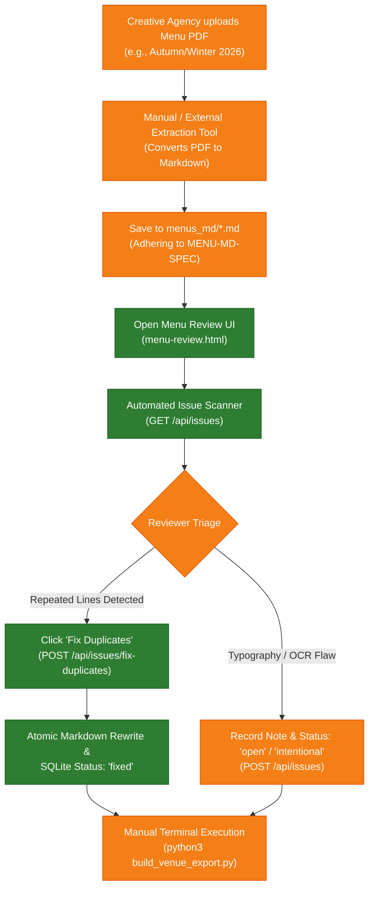
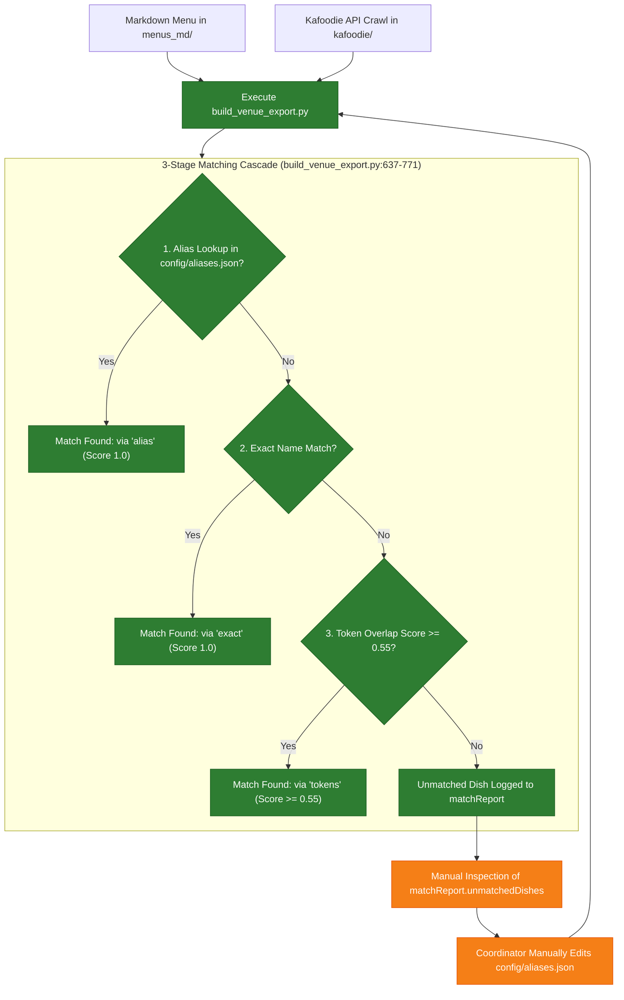
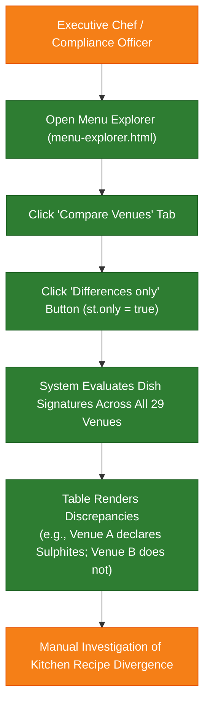
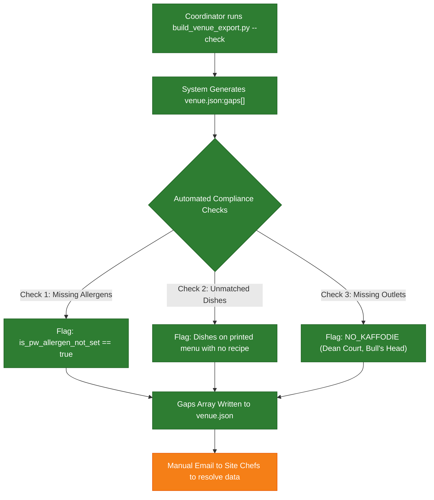

# Document 04 — Operational Workflow Map

> **Hospitality Technology Capability Assessment — The Inn Collection Group**  
> **Phase**: System Architecture & Technical Verification  
> **Standard Key**: `[Observed]` · `[Code-verified]` · `[Database-verified]` · `[Tested]` · `[Inferred]` · `[Proposed]` · `[Unknown]`

---

## 1. Overview & Operational Persona

In a multi-site hospitality estate of 31 coaching inns, the **Food & Beverage (F&B) Systems Coordinator** serves as the operational linchpin connecting central commercial teams, marketing design agencies, development chefs, site general managers, and EPOS engineers.

This document maps the eight core operational workflows of this role, clearly distinguishing between:
* **Automated & Code-Verified Stages** (green/solid): Currently functioning in the codebase.
* **Manual Interventions & Operational Friction** (amber): Human steps required due to missing tooling.
* **Unimplemented / Conceptual Stages** (grey/dashed): Capabilities modeled in UI mockups but absent from the backend.

---

## 2. Operational Hospitality Workflows

### 2.1 Workflow 1: Intake & Quality Control of a New Seasonal Menu PDF

* **Primary User**: F&B Systems Coordinator / Marketing Coordinator.
* **Inputs**: PDF menu files from graphic design agencies.
* **Outputs**: Validated, cleaned Markdown menu stored in `menus_md/` and tracked in SQLite.
* **Manual Interventions**:
  1. `[Code-verified]`: Converting the PDF into Markdown is an external, manual task before the file enters `menus_md/`.
  2. `[Code-verified]`: After resolving issues in `menu-review.html`, the coordinator must manually switch to a terminal and run `python3 build_venue_export.py` to update downstream JSON files.

---

### 2.2 Workflow 2: Reconciling Printed Dishes to Kafoodie Central Recipes

* **Primary User**: F&B Systems Coordinator.
* **Inputs**: Cleaned menu Markdown, Kafoodie outlet JSON files, `config/aliases.json`.
* **Outputs**: `venue.json` with linked `product` IDs and `matchReport` metrics.
* **Manual Interventions**:
  1. `[Code-verified]`: When dishes fail to match (e.g. printed "Classic Whitby Scampi" vs Kafoodie "Scampi & Chips"), the coordinator must open `config/aliases.json` in a text editor, write a JSON entry, and rerun the build script.

---

### 2.3 Workflow 3: Cross-Venue Variance Auditing (Allergen & Calorie Inconsistencies)

* **Primary User**: Group Executive Chef / Food Safety Compliance Officer (`[Inferred]` operational role).
* **Inputs**: `menu-explorer-data.js` compiled across all outlets (offline static snapshot).
* **Outputs**: Client-side comparison table of a generated data snapshot highlighting differences in available recipe, allergen, and nutritional declarations across properties.
* **Operational Reality**: `[Tested]`. Evaluates dish signatures across the static dataset. Identifying differences does not establish whether those differences are current, approved, intentional, or operationally accurate; it requires human investigation to establish cause and operational significance. It does not provide live monitoring or automatic change detection.

---

### 2.4 Workflow 4: Identifying Missing Information & Compliance Blockers

* **Primary User**: F&B Coordinator / Head of Food.
* **Inputs**: Venue crawl files, Markdown files.
* **Outputs**: Generated plain-English gap register inside `venue.json:gaps`.
* **Code Evidence**: `build_venue_export.py:1268-1290` automatically evaluates and generates text warnings:
  * *"12 dishes have no matched Kafoodie recipe and cannot show allergens or nutrition."*
  * *"3 recipes have no allergen data set in Kafoodie."*

---

### 2.5 Workflow 5: Seasonal Launch Preparation (Current vs. Intended)

| Operational Stage | Intended Workflow (from `launch-readiness.html`) | Actual Code Reality | Operational Gap |
| :--- | :--- | :--- | :--- |
| **1. Milestone Triage** | Central F&B sets completion dates for Print, EPOS, Recipe Specs, and FOH Briefing. | Hardcoded in client-side JS; no database storage. | `[Code-verified]` Reset on reload; cannot be shared across team. |
| **2. Recipe Signoff** | Head Chefs verify culinary specs and portion grammages. | Detailed specs exist **only** for Chicken Liver Parfait (`pages/recipes/`). | `[Observed]` No digital spec sheets exist for other 200+ dishes. |
| **3. EPOS Setup** | PLU numbers assigned, tills programmed, modifier groups verified. | **Zero implementation**. No EPOS codes exist in any file. | `[Code-verified]` Completely manual process outside the system. |
| **4. Site Readiness** | General Managers check off staff tasting and allergen briefing. | Checklist clicks update DOM progress bars only. | `[Code-verified]` Unpersisted; no multi-site progress tracking. |
