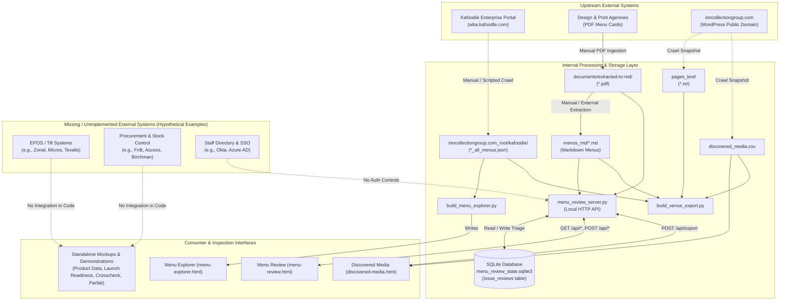

# Document 05 — Integration and Dependency Register

> **Hospitality Technology Capability Assessment — The Inn Collection Group**  
> **Phase**: System Architecture & Technical Verification  
> **Standard Key**: `[Observed]` · `[Code-verified]` · `[Database-verified]` · `[Tested]` · `[Inferred]` · `[Proposed]` · `[Unknown]`

---

## 1. System Integration Map

This register documents every verified data connection, API link, file dependency, and boundary interface across the Inn Collection Group capability suite.

---

## 2. Register of Verified Existing Connections

| Source Component | Target Component | Connection Mechanism | Data Transferred | Operational Impact | Verification |
| :--- | :--- | :--- | :--- | :--- | :--- |
| **`menus_md/*.md`** | **`menu_review_server.py`** | File System I/O | Raw UTF-8 Markdown text. | Powers `/api/menus` catalog and `/api/menu` content delivery. | `[Code-verified]` |
| **`documents/*.pdf`** | **`menu_review_server.py`** | File System I/O | Binary PDF byte stream. | Streams original menu PDF to `<iframe>` via `/api/pdf?name=...`. | `[Code-verified]` |
| **`menu_review_server.py`** | **`menu_review_state.sqlite3`** | Python `sqlite3` driver | SQL `INSERT ... ON CONFLICT`, `SELECT`. | Persists review status (`open`, `fixed`, `intentional`) and line-removal logs. | `[Database-verified]` |
| **`menu-review.html`** | **`menu_review_server.py`** | Asynchronous HTTP `fetch()` | JSON payloads & Markdown text. | Drives interactive review, issue detection, and duplicate line removal. | `[Tested]` |
| **`kafoodie/*.json`** | **`build_menu_explorer.py`** | Python `json.load()` | Outlet metadata, recipe trees, allergen objects. | Deduplicates outlets and extracts statutory allergen reference dictionary. | `[Code-verified]` |
| **`build_menu_explorer.py`** | **`menu-explorer-data.js`** | File System Write | Serialized JavaScript object (`window.MENU_DATA`). | Provides single-file zero-latency data bundle for Menu Explorer. | `[Code-verified]` |
| **`menus_md/*.md` + `kafoodie/*.json`** | **`build_venue_export.py`** | Python Pipeline (`1,376 lines`) | Full relational reconciliation. | Compiles canonical `venue.json` and human-readable `venue.md` per property. | `[Code-verified]` |
| **`discovered-media.html`** | **`menu_review_server.py`** | HTTP `POST /api/export` | JSON list of asset URLs and target folder structure. | Downloads assets into organized local folders under `exports/`. | `[Tested]` |

---

## 3. Register of Missing & Disconnected Integrations

### 3.1 Internal Pipeline Disconnects (Within the Repository)
1. **Menu Review QC -> Venue Export Pipeline**:
   * *Status*: `[Code-verified]` **Disconnected**.
   * *The Gap*: When an F&B coordinator marks an issue as `fixed` or removes duplicate lines in `menu-review.html`, the change is saved in SQLite and the `.md` file is rewritten. However, **no build hook triggers `build_venue_export.py`**. The canonical export remains stale until manually rebuilt.
2. **Venue Export (`venue.json`) -> Product Data Interface (`product-data.html`)**:
   * *Status*: `[Code-verified]` **Disconnected**.
   * *The Gap*: `build_venue_export.py` generates rich `products[]` records with full allergen, dietary, and pricing details. However, `product-data.html` does not consume this file; it displays hardcoded mock data.
3. **Venue Export Coverage -> Launch Readiness (`launch-readiness.html`)**:
   * *Status*: `[Code-verified]` **Disconnected**.
   * *The Gap*: `venue.json:coverage` explicitly tracks the percentage of printed dishes matched to recipes (`dishesMatchedToProduct / dishes`), but `launch-readiness.html` computes progress bars from temporary client-side checkboxes.

### 3.2 External System Disconnects
1. **EPOS / Point-of-Sale Systems (Industry examples: Zonal, Micros, Tevalis)**:
   * *Status*: `[Code-verified]` **Zero Integration**.
   * *The Reality*: There is no API client, webhook, CSV export format, or database schema for EPOS PLU codes, till pricing, or modifier groups. (Note: Specific vendor platforms are cited purely as illustrative industry examples; no evidence exists that ICG uses these particular systems).
2. **Kafoodie Upstream API (Live Sync)**:
   * *Status*: `[Code-verified]` **Static Crawl Snapshot**.
   * *The Reality*: The repository reads downloaded `.json` files in `kafoodie/`. If a development chef updates a recipe in Kafoodie, changes do not appear in the workspace until an engineer executes an external web crawl.
3. **User Authentication & Role Governance (Industry examples: Okta, Azure AD)**:
   * *Status*: `[Code-verified]` **Zero Access Control**.
   * *The Reality*: The local `menu_review_server.py` does not enforce authentication. Any client on the local network can trigger file modifications via `/api/issues/fix-duplicates`.

---

## 4. Upstream & Downstream Dependency Matrix

| Dependency | Nature | Criticality | Risk Description | Fallback Mechanism |
| :--- | :--- | :--- | :--- | :--- |
| **Local SQLite Engine** | Runtime Binary | **High** | Corrupted database blocks review state and duplicate line fixing. | Local file backup. `pages/seed_reviews.json` exists as a static single-record browser UI fallback if `/api/issues` fails, but the local Python server does not read it and does not provide automated database recovery (`[Code-verified]`). |
| **PDF Extraction Quality** | Ingestion Feed | **High** | Poor OCR in external tools introduces repeated lines, truncated descriptions, or missed prices. | Manually audited and remediated in `menu-review.html`. |
| **Kafoodie Outlet IDs** | Relational Anchor | **Critical** | Venues lacking an outlet ID (Dean Court, Bull's Head) cannot generate structured product data. | None currently; venues are excluded via `NO_KAFFODIE`. |
| **Python Standard Library** | Execution Runtime | **Low** | Requires Python 3.8+ on the host system; zero pip package dependencies. | Highly resilient; runs on standard macOS/Linux system binaries. |
