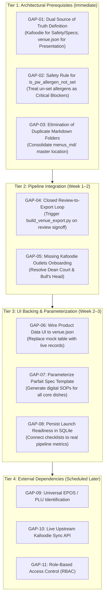

# Document 06 — Capability Gaps and Development Priorities

> **Hospitality Technology Capability Assessment — The Inn Collection Group**  
> **Phase**: System Architecture & Technical Verification  
> **Standard Key**: `[Observed]` · `[Code-verified]` · `[Database-verified]` · `[Tested]` · `[Inferred]` · `[Proposed]` · `[Unknown]`

---

## 1. Prioritization Framework & Governance Principles

This document provides a disciplined, prioritized roadmap for developing the Inn Collection Group hospitality technology workspace. 

Following the primary instruction of this phase:
> **Do not prematurely redesign, refactor, or expand the application.**  
> Map the operational reality first, stabilize the data foundation, and prioritize closing existing gaps before implementing speculative features.

Each gap and development initiative is categorized according to its immediate necessity:
* **Tier 1: Architectural Prerequisites**: Critical decisions required before further code is written.
* **Tier 2: Pipeline Integration Priorities**: Connecting existing working tools into an automated loop.
* **Tier 3: Operational UI Backing**: Replacing volatile prototypes with real data feeds.
* **Tier 4: Deferred External Capabilities**: Features dependent on third-party systems or commercial decisions.
* **Explicitly Out of Scope**: Initiatives that must not be pursued at this stage.

---

## 2. Capability Gaps Register & Triage

---

## 3. Detailed Gap Assessment

### Tier 1: Architectural Prerequisites (Immediate Action Required)

#### GAP-01: Authoritative Source of Truth Boundary
* **Nature**: `[Code-verified]` Relational Ambiguity.
* **Existing Technical Behaviour**: The codebase ingests Kafoodie JSON crawls for recipes/allergens and Markdown menus for prices/descriptions, merging them offline into `venue.json`. Neither source is defined in software as globally authoritative over the other.
* **Observed Source-Data Characteristics**: Kafoodie holds culinary recipe components, yields, and nutritional calculations, but printed menu cards hold guest-facing dish titles, descriptions, section groupings, and printed prices.
* **Proposed Future Arrangement `[Proposed]`**:
  1. *Proposed Kafoodie Role*: Authoritative for central recipes, allergen declarations, and nutritional profiles.
  2. *Proposed Venue Export Role*: Derived canonical representation for guest-facing menu presentation, section placement, and localized pricing.
* **Required Business Decision**: Formal ratification of this authority boundary must be confirmed by operational and business stakeholders (Executive Chef, F&B Operations, Legal/Compliance) before being hardcoded as business policy.

#### GAP-02: Tracking Data Provenance for Incomplete Recipe Declarations
* **Nature**: `[Database-verified]` Data Completeness & Verification Tracking.
* **Analysis**: In `menu-explorer-data.js` and `venue.json`, dishes with `is_pw_allergen_not_set == true` reflect upstream recipe entries where allergen details were omitted during Kafoodie entry.
* **Required Direction**: Surface data provenance and verification flags transparently in explorer interfaces (e.g., indicating "Unverified / Pending Supplier Data"). Note that legal compliance, allergen liability, and menu publication policies are governance decisions that rest strictly with business, culinary, and legal stakeholders rather than technical automation.

#### GAP-03: Elimination of Duplicate Menu Directories
* **Nature**: `[Code-verified]` Technical Debt & Orphaned Directory.
* **Analysis**: `inncollectiongroup.com_root/menus_md/` and `pages/menus_md/` both contain 103 identical Markdown files. The local server and build scripts read and write exclusively to `inncollectiongroup.com_root/menus_md/`. Following the complete decommissioning of Netlify (Document 07), `pages/menus_md/` is now fully orphaned.
* **Required Decision**: Delete `pages/menus_md/` upon business confirmation, standardizing all tools on the single master directory `inncollectiongroup.com_root/menus_md/`.

---

### Tier 2: Pipeline Integration Priorities (Near-Term Engineering)

#### GAP-04: Closed Loop Between Menu Review and Venue Export
* **Current State**: `[Code-verified]`. Triage decisions and duplicate-line cleanups in `menu-review.html` write to SQLite, but do not update `venue.json`.
* **Action Required**: Add an automated rebuild hook or one-click "Publish Approved Menu" action in `menu-review.html` that triggers `build_venue_export.py` for the affected venue upon completion of all issues.

#### GAP-05: Missing Outlets Resolution (Dean Court & Bull's Head)
* **Current State**: `[Code-verified]`. `build_menu_explorer.py:43` explicitly lists `NO_KAFFODIE = ["Dean Court", "The Bull's Head Inn"]`.
* **Action Required**: Obtain the correct Kafoodie outlet IDs for these two properties or establish a local recipe fallback schema, bringing all 31 properties into the structured data catalog.

---

### Tier 3: Operational UI Backing & Template Parameterization

#### GAP-06: Backing Product Data Interface with Live Data
* **Current State**: `[Observed]`. `pages/product-data.html` is a visual mockup with hardcoded HTML rows.
* **Action Required**: Re-wire the page's JavaScript to ingest `exports/<Venue>/venue.json:products[]`, transforming it into an active estate catalog with live search, allergen filters, and compliance blocker indicators.

#### GAP-07: Extracting the Parfait Layout into a Reusable Dish Spec Engine
* **Current State**: `[Observed]`. `pages/recipes/chicken-liver-parfait...html` demonstrates an exceptional "hub-and-spoke" operational specification layout, but is hardcoded for exactly one recipe.
* **Action Required**: Refactor the layout into a parameter-driven template (`dish-spec.html?id=<recipe_id>`) dynamically populated from `venue.json`.

#### GAP-08: Persisting Launch Readiness State in SQLite
* **Current State**: `[Code-verified]`. `pages/launch-readiness.html` stores checklist toggles in volatile DOM memory.
* **Action Required**: Add a `launch_checklists` table to `menu_review_state.sqlite3` and auto-populate milestone readiness percentages from `venue.json:coverage` statistics.

---

### Tier 4: Deferred External Capabilities (Scheduled for Subsequent Phases)

| Initiative | Dependency | Reason for Deferral |
| :--- | :--- | :--- |
| **Universal EPOS / PLU Programming** | External EPOS Vendor (Zonal, Micros, Tevalis) | Requires API access, POS hardware specs, and commercial till mapping not yet defined in the project scope. |
| **Live Upstream Kafoodie Sync** | Kafoodie Enterprise API Credentials | Currently operates effectively on batch crawl snapshots; automated live webhooks require enterprise vendor coordination. |
| **Role-Based Access Control (RBAC)** | Identity Provider (Azure AD / Okta) | Unnecessary during local single-user inspection phase; should be integrated when central multi-user deployment begins. |
| **Dynamic Supplier Price Tracking** | Food Vendor EDI Invoices (Brakes, etc.) | Recipe cost prices and supplier pack sizes are currently static; live price tracking requires procurement ERP integration. |

---

## 4. Explicitly Out of Scope for Immediate Development

To ensure development resources remain focused on core operational value, the following activities are strictly out of scope:
1. **Frontend Framework Rewrites**: Migrating the interfaces to React, Next.js, or Vue. The existing vanilla JavaScript architecture is fast, robust, and zero-dependency.
2. **Replacing SQLite with an Enterprise Cloud Database**: SQLite is perfectly suited for the current review volume and local operational runtime.
3. **Redesigning Visual Themes or Branding**: The luxury editorial styling (Cormorant Garamond, Barlow Semi Condensed) is highly effective and does not require cosmetic changes.
4. **Autonomous AI Allergen Generation**: LLMs must never be permitted to infer or author food-safety records without explicit human culinary certification.
