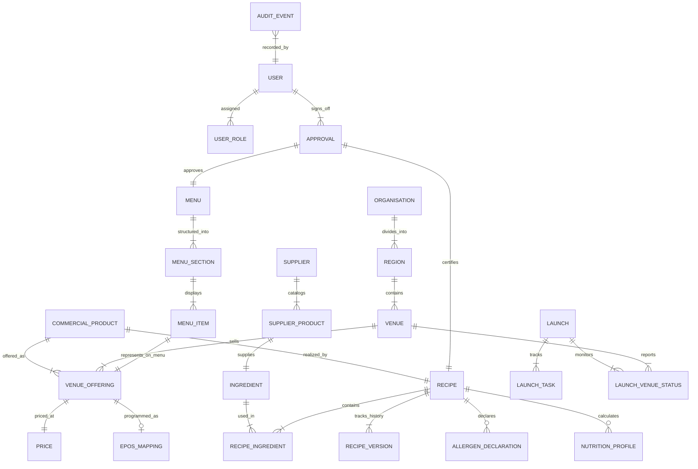

# Document 10 — Target Data Architecture and Entity Model

> **Knowledge Base** · Inn Collection Group (ICG) Hospitality Technology Workspace  
> **Document** 10 of 15 · Published: 2026-11-22  
> **Phase**: Phase 2 — Hospitality Technology Requirements, Target Architecture & Implementation Blueprint  
> **Evidence Standards**: `[Code-verified]` · `[Database-verified]` · `[Data-verified]` · `[Inferred]` · `[Proposed]` · `[Requires-confirmation]`

---

## 1. Executive Summary & Architectural Philosophy

This document defines the target data architecture and entity relationship model for The Inn Collection Group (ICG) multi-site food and beverage management platform.

The architectural investigation in Documents 01–08 established that the current codebase lacks an integrated relational database: 95% of the estate's structured data lives in derived JSON files (`venue.json`, `menu-explorer-data.js`), while the sole persistent SQL table (`issue_reviews`) stores only review triage decisions.

The target data architecture introduces a coherent, multi-tier data model designed to solve the fundamental data disconnect in hospitality operations:
```
COMMERCIAL INTENT                  CULINARY SPECIFICATION            GUEST PRESENTATION
┌──────────────────────┐          ┌──────────────────────┐          ┌──────────────────────┐
│  COMMERCIAL PRODUCT  │          │    KITCHEN RECIPE    │          │  PRINTED MENU ITEM   │
│ Master SKU, Category,│◄────────►│ Ingredients, Yield,  │◄────────►│ Guest Title, Section,│
│ Commercial Strategy  │          │ Allergens, Nutrition │          │ Marketing Copy, Price│
└──────────────────────┘          └──────────────────────┘          └──────────────────────┘
           ▲                                                                   ▲
           │                                                                   │
           └───────────────────────────┬───────────────────────────────────────┘
                                       ▼
                          ┌──────────────────────────┐
                          │      VENUE OFFERING      │
                          │ Local Site Availability, │
                          │ Local Price Tier, EPOS   │
                          └──────────────────────────┘
```

By decoupling these three concepts and binding them at the **Venue Offering** layer, the architecture resolves the historical tension between culinary recipes, printed menu cards, and till configurations.

---

## 2. Multi-Tier Source-of-Truth Architecture

A major finding of the technical assessment is that **no single system is or should be authoritative across all hospitality data domains**. Declaring Kafoodie or printed menu cards universally authoritative creates irreconcilable data conflicts.

The target architecture establishes an explicit, domain-specific authority matrix:

| Information Domain | Authoritative Master Source | Secondary / Derived Consumers | Ingestion & Synchronization Mechanism | Authority Status |
| :--- | :--- | :--- | :--- | :---: |
| **Culinary Recipes & Prep SOPs** | **Kafoodie Enterprise Portal** | Platform Recipe Catalog, Kitchen Spec Books | Structured API sync / Crawl ingestion | `[Proposed]` |
| **Ingredients, Yields & Portions** | **Kafoodie / Kitchen Specs** | Food Information Management, Costing Engine | API payload mapping | `[Proposed]` |
| **Statutory Allergen Declarations** | **Supplier Tech Specs & Kafoodie** | Menu Explorer, Allergen Matrix, Guest Web | Strict verification workflow; sign-off required | `[Requires-confirmation]` |
| **Nutritional Profiles (FIR)** | **Kafoodie Nutritional Engine** | Explorer data bundle, digital menus | Calculated per 100g and portion size | `[Proposed]` |
| **Guest Menu Copy & Sections** | **Marketing & F&B Menu Team** | Printed PDF menus, digital web menus, venue displays | Central Menu Authoring Module | `[Proposed]` |
| **Commercial Selling Prices** | **Commercial Strategy Team** | EPOS till database, printed menus, financial models | Central Price Master with venue tier rules | `[Proposed]` |
| **Ingredient Purchase Costs** | **Procurement / Supplier Feeds** | Recipe Costing Engine, GP% Margin Models | Supplier catalog imports (CSV / EDI) | `[Proposed]` |
| **Till PLU Codes & Screen Layout**| **Central EPOS Master** | Local Inn Till Terminals, Sales Mix Reports | EPOS export payloads (CSV / API adapter) | `[Proposed]` |
| **Venue Master Profiles & Regions**| **Corporate Operations Master** | All modules, reporting rollups, web scraper | `config/venues.json` -> SQL `venues` table | `[Code-verified]` |
| **Document Triage & QC Audits** | **Local Platform Review Engine** | Markdown master menus, issue history | SQLite `issue_reviews` table | `[Database-verified]` |

---

## 3. Data Classification Framework

All system data is classified into seven distinct architectural storage categories:

1. **Master Data**: Core business entities representing the nouns of the enterprise (Commercial Products, Recipes, Ingredients, Menus, Venues, Suppliers). High stability, strict governance, and versioned lifecycles.
2. **Reference Data**: Standardized domain lookup codes and dictionaries (14 FIR Allergens, Dietary Codes `[V, Ve, GF, GFi]`, Menu Kinds `[Autumn, Festive, Drinks]`, Regions, Tax Rates).
3. **Transactional Data**: Execution and commercial event data (Sales mix quantities, batch ingredient purchases, inventory waste logs). External in current scope.
4. **Derived Data**: Synthesized analytical views calculated on-the-fly or compiled offline (Dish COGS, Gross Profit %, Cross-Venue Variance Matrices, `venue.json` snapshots).
5. **Workflow State**: Mutable operational coordination flags (Launch task RAG statuses, menu approval stages, issue triage decisions `[open, fixed, intentional]`).
6. **Audit History**: Immutable chronological event logs capturing user identity, timestamp, entity altered, old value, and new value for regulatory traceability.
7. **External-System Data**: Cached read-only snapshots originating from external platforms (EPOS PLU registers, raw Kafoodie outlet JSON dumps).

---

## 4. Entity Relationship Model & Definitions

### 4.1 Target Entity Relationship Diagram (Mermaid)



---

### 4.2 Comprehensive Entity Dictionary (26 Core Entities)

The 26 candidate domain entities required to support the F&B Coordinator operational ecosystem are defined below:

#### 1. Organisation
* **Why it exists**: Top-level corporate legal entity representing The Inn Collection Group.
* **Attributes**: `org_id` (PK, UUID), `name` (String: "The Inn Collection Group"), `head_office_address` (JSON), `created_at` (Timestamp).
* **Relationships**: 1:N with Region.
* **Classification**: Master Data. Persisted in SQL. Authority: Corporate Legal.

#### 2. Region
* **Why it exists**: Geographical operational cluster for management oversight, pricing tiers, and regional menus.
* **Attributes**: `region_id` (PK, String: "lake-district"), `name` (String: "Lake District"), `operations_manager_name` (String).
* **Relationships**: N:1 with Organisation; 1:N with Venue.
* **Classification**: Reference Data. Persisted in SQL. Authority: Operations Director.

#### 3. Venue (Site / Inn)
* **Why it exists**: Physical hospitality property where food, drinks, and rooms are sold (29 active inns).
* **Attributes**: `venue_id` (PK, String: "the-kingslodge-inn"), `outlet_id` (Integer, Kafoodie ID), `name` (String), `region_id` (FK), `slug` (String), `address` (JSON), `phone` (String), `price_tier_id` (FK), `is_active` (Boolean).
* **Relationships**: N:1 with Region; 1:N with Venue Offering; 1:N with Launch Venue Status.
* **Classification**: Master Data. Persisted in SQL. Authority: Operations Director.

#### 4. Supplier
* **Why it exists**: Commercial vendor contracted to deliver food, beverage, or consumable products.
* **Attributes**: `supplier_id` (PK, UUID), `name` (String: "Bidfood", "Davy's Wine"), `account_number` (String), `lead_time_days` (Integer), `ordering_email` (String), `is_approved` (Boolean).
* **Relationships**: 1:N with Supplier Product.
* **Classification**: Master Data. Persisted in SQL. Authority: Head of Procurement.

#### 5. Supplier Product
* **Why it exists**: Specific commercial item purchased from a supplier, defining pack size and purchasing cost.
* **Attributes**: `supplier_product_id` (PK, UUID), `supplier_id` (FK), `supplier_sku` (String), `name` (String), `pack_size` (String: "6x1kg"), `pack_unit` (String: "kg"), `pack_quantity` (Decimal: 6.0), `case_cost_net` (Decimal: £42.50), `split_permitted` (Boolean), `unit_cost_net` (Decimal: £7.08/kg).
* **Relationships**: N:1 with Supplier; 1:1 with Ingredient.
* **Classification**: Master Data. Persisted in SQL. Authority: Procurement.

#### 6. Ingredient
* **Why it exists**: Standardized culinary raw material used in kitchen recipes, converted to standard culinary units (grams, milliliters, each).
* **Attributes**: `ingredient_id` (PK, UUID), `name` (String: "Salted Butter"), `category` (String: "Dairy"), `culinary_unit` (String: "g"), `unit_cost` (Decimal: £0.0071/g), `supplier_product_id` (FK), `allergen_bitmask` (Integer).
* **Relationships**: N:1 with Supplier Product; 1:N with Recipe Ingredient.
* **Classification**: Master Data. Persisted in SQL. Authority: Development Chef / Procurement.

#### 7. Recipe
* **Why it exists**: Standard culinary specification defining how a dish or culinary component is prepared.
* **Attributes**: `recipe_id` (PK, UUID), `code` (String: "REC-PARFAIT-01"), `name` (String: "Chicken Liver Parfait"), `category` (String: "Starters"), `yield_portions` (Integer: 12), `prep_time_minutes` (Integer: 45), `cook_time_minutes` (Integer: 60), `instructions_markdown` (Text), `plating_sop_url` (String), `status` (Enum: Draft, In-Review, Approved, Retired).
* **Relationships**: 1:N with Recipe Ingredient; 1:N with Recipe Version; 1:1 with Commercial Product; 1:1 with Nutrition Profile; 1:N with Allergen Declaration.
* **Classification**: Master Data. Persisted in SQL. Authority: Group Executive Chef.

#### 8. Recipe Version
* **Why it exists**: Immutable historical record of recipe formulations over time, ensuring auditability of ingredient and allergen changes.
* **Attributes**: `version_id` (PK, UUID), `recipe_id` (FK), `version_number` (Integer), `effective_from` (Date), `effective_to` (Date, Nullable), `change_summary` (Text), `approved_by` (FK, User), `approved_at` (Timestamp).
* **Relationships**: N:1 with Recipe.
* **Classification**: Audit History. Persisted in SQL. Authority: Executive Chef.

#### 9. Recipe Ingredient (Bill of Materials)
* **Why it exists**: Associative entity mapping ingredients into recipes with precise portion quantities and wastage factors.
* **Attributes**: `recipe_ingredient_id` (PK, UUID), `recipe_id` (FK), `ingredient_id` (FK), `quantity` (Decimal: 250.0), `unit` (String: "g"), `waste_percentage` (Decimal: 5.0), `prep_notes` (String: "Diced 1cm"), `sort_order` (Integer).
* **Relationships**: N:1 with Recipe; N:1 with Ingredient.
* **Classification**: Master Data. Persisted in SQL. Authority: Development Chef.

#### 10. Commercial Product
* **Why it exists**: Commercial trading item sold to guests, bridging central recipes to the financial and brand architecture.
* **Attributes**: `product_id` (PK, UUID), `master_sku` (String: "PRD-CLP-001"), `name` (String: "Chicken Liver Parfait"), `recipe_id` (FK), `brand` (String: "ICG Traditional"), `sales_category` (String: "Food"), `is_active` (Boolean).
* **Relationships**: 1:1 with Recipe; 1:N with Venue Offering.
* **Classification**: Master Data. Persisted in SQL. Authority: Commercial Manager & F&B Coordinator.

#### 11. Menu
* **Why it exists**: Top-level collection of dishes and beverages presented to guests during specific service windows.
* **Attributes**: `menu_id` (PK, UUID), `code` (String: "AUTUMN-DINNER-2026"), `title` (String: "Autumn / Winter Main Menu"), `kind` (Enum: Food, Drinks, Sunday, Festive, Breakfast), `valid_from` (Date), `valid_to` (Date), `status` (Enum: Draft, Approved, Published, Archived).
* **Relationships**: 1:N with Menu Section; 1:N with Approval.
* **Classification**: Master Data. Persisted in SQL. Authority: F&B Coordinator.

#### 12. Menu Section
* **Why it exists**: Structural categorization within a printed or digital menu (e.g. Starters, Pub Classics, Steaks, Desserts).
* **Attributes**: `section_id` (PK, UUID), `menu_id` (FK), `title` (String: "While You Wait"), `subtitle` (String), `sort_order` (Integer), `display_columns` (Integer: 1, 2, or 3).
* **Relationships**: N:1 with Menu; 1:N with Menu Item.
* **Classification**: Master Data. Persisted in SQL. Authority: F&B Coordinator.

#### 13. Menu Item
* **Why it exists**: Specific printed entry on a physical or digital menu card, including guest-facing prose and dietary markers.
* **Attributes**: `menu_item_id` (PK, UUID), `section_id` (FK), `product_id` (FK), `display_title` (String: "Homemade Chicken Liver Parfait"), `guest_description` (Text), `printed_price` (Decimal: £8.95), `dietary_tags` (Array: ["GFi"]), `sort_order` (Integer), `is_featured` (Boolean).
* **Relationships**: N:1 with Menu Section; N:1 with Commercial Product; 1:1 with Venue Offering.
* **Classification**: Master Data. Persisted in SQL. Authority: F&B Coordinator.

#### 14. Venue Offering
* **Why it exists**: The physical availability of a commercial product at a specific inn, binding local pricing, local recipes, and till mappings.
* **Attributes**: `offering_id` (PK, UUID), `venue_id` (FK), `product_id` (FK), `menu_item_id` (FK, Nullable), `is_available` (Boolean), `local_price` (Decimal: £9.25), `override_recipe_id` (FK, Nullable), `status` (Enum: Active, Suspended, Out-of-Stock).
* **Relationships**: N:1 with Venue; N:1 with Commercial Product; N:1 with Menu Item; 1:1 with Price; 1:1 with EPOS Mapping.
* **Classification**: Master Data (Binding Entity). Persisted in SQL. Authority: F&B Coordinator & General Manager.

#### 15. Price
* **Why it exists**: Commercial retail pricing definition, encapsulating VAT and currency.
* **Attributes**: `price_id` (PK, UUID), `offering_id` (FK), `gross_price` (Decimal: £8.95), `vat_rate` (Decimal: 0.20), `net_price` (Decimal: £7.46), `currency` (String: "GBP"), `effective_from` (Date), `effective_to` (Date, Nullable).
* **Relationships**: 1:1 with Venue Offering.
* **Classification**: Master Data. Persisted in SQL. Authority: Commercial Manager.

#### 16. Product Code / EPOS Mapping
* **Why it exists**: Point-of-sale terminal lookup configuration, ensuring till keys ring up the correct item, price, and kitchen printer.
* **Attributes**: `epos_mapping_id` (PK, UUID), `offering_id` (FK), `plu_code` (String: "10245"), `till_button_label` (String: "PARFAIT"), `epos_category_code` (String: "STARTERS"), `kitchen_printer_route` (String: "LARDER_1"), `is_configured` (Boolean), `last_synced_at` (Timestamp).
* **Relationships**: 1:1 with Venue Offering.
* **Classification**: Master Data. Persisted in SQL. Authority: Systems Administrator.

#### 17. Allergen Declaration
* **Why it exists**: Rigorous statutory declaration of allergen presence per recipe and ingredient in accordance with UK FIR standards.
* **Attributes**: `declaration_id` (PK, UUID), `recipe_id` (FK), `allergen_code` (Enum: 1 to 14), `allergen_name` (String: "Milk"), `containment_type` (Enum: Contains, May-Contain, Free-From), `is_verified` (Boolean), `verified_by` (FK, User), `verified_at` (Timestamp), `source_document_id` (FK, Nullable).
* **Relationships**: N:1 with Recipe; N:1 with Source Document.
* **Classification**: Master Data. Persisted in SQL. Authority: Food Safety Compliance Officer.

#### 18. Nutrition Profile
* **Why it exists**: Statutory nutritional data per portion and per 100g.
* **Attributes**: `nutrition_id` (PK, UUID), `recipe_id` (FK), `portion_grams` (Decimal: 180.0), `energy_kcal` (Decimal: 412.0), `energy_kj` (Decimal: 1720.0), `fat_g` (Decimal: 28.4), `sat_fat_g` (Decimal: 14.2), `carbs_g` (Decimal: 12.1), `sugar_g` (Decimal: 3.4), `protein_g` (Decimal: 18.6), `salt_g` (Decimal: 1.12), `calculation_method` (Enum: Laboratory, Calculated, Supplier).
* **Relationships**: 1:1 with Recipe.
* **Classification**: Master Data. Persisted in SQL. Authority: Kafoodie Engine / Technical Chef.

#### 19. Source Document
* **Why it exists**: Physical or digital file providing provenance for recipes, allergen declarations, or menu layouts.
* **Attributes**: `document_id` (PK, UUID), `file_path` (String), `file_hash` (String, SHA-256), `file_type` (Enum: PDF, CSV, DOCX, JSON), `category` (Enum: Printed-Menu, Supplier-Spec, Lab-Report, Brand-Pack), `uploaded_at` (Timestamp), `uploaded_by` (FK, User).
* **Relationships**: 1:N with Allergen Declaration; 1:N with Verification Record.
* **Classification**: Reference Data. Persisted on disk + SQL metadata. Authority: F&B Coordinator.

#### 20. Verification Record
* **Why it exists**: Formal sign-off attaching human responsibility to a specific piece of technical, allergen, or pricing data.
* **Attributes**: `verification_id` (PK, UUID), `target_entity_type` (String: "Recipe"), `target_entity_id` (UUID), `status` (Enum: Verified, Rejected, Pending-Supplier), `notes` (Text), `verified_by` (FK, User), `verified_at` (Timestamp).
* **Relationships**: N:1 with User.
* **Classification**: Audit History. Persisted in SQL. Authority: Compliance Officer.

#### 21. Launch Campaign
* **Why it exists**: Project management master tracking seasonal menu changeover campaigns across the estate.
* **Attributes**: `launch_id` (PK, UUID), `name` (String: "Spring / Summer 2026 Rollout"), `target_go_live` (Date), `rag_status` (Enum: Green, Amber, Red), `lead_coordinator_id` (FK, User), `created_at` (Timestamp).
* **Relationships**: 1:N with Launch Task; 1:N with Launch Venue Status.
* **Classification**: Workflow State. Persisted in SQL. Authority: F&B Coordinator.

#### 22. Launch Task
* **Why it exists**: Actionable workstream milestone assigned to a department or individual leading up to a launch.
* **Attributes**: `task_id` (PK, UUID), `launch_id` (FK), `workstream` (Enum: FNB, Marketing, Operations, Procurement, Finance, Systems), `title` (String: "EPOS PLU Database Built"), `assigned_to` (FK, User), `due_date` (Date), `is_complete` (Boolean), `completed_at` (Timestamp, Nullable).
* **Relationships**: N:1 with Launch Campaign; N:1 with User.
* **Classification**: Workflow State. Persisted in SQL. Authority: F&B Coordinator.

#### 23. Launch Venue Status
* **Why it exists**: Operational readiness tracker monitoring launch preparation per individual inn.
* **Attributes**: `status_id` (PK, UUID), `launch_id` (FK), `venue_id` (FK), `spec_pack_delivered` (Boolean), `team_briefed` (Boolean), `epos_programmed` (Boolean), `readiness_percentage` (Integer: 0 to 100), `signoff_gm_name` (String), `signed_off_at` (Timestamp, Nullable).
* **Relationships**: N:1 with Launch Campaign; N:1 with Venue.
* **Classification**: Workflow State. Persisted in SQL. Authority: Area Operations Manager.

#### 24. User
* **Why it exists**: Named individual interacting with the hospitality platform.
* **Attributes**: `user_id` (PK, UUID), `email` (String), `full_name` (String), `department` (String), `is_active` (Boolean).
* **Relationships**: 1:N with User Role; 1:N with Approval; 1:N with Audit Event.
* **Classification**: Master Data. Persisted in SQL. Authority: Systems Admin.

#### 25. User Role (RBAC)
* **Why it exists**: Functional role determining permission boundaries across recipes, menus, costs, and publication gates.
* **Attributes**: `role_id` (PK, UUID), `user_id` (FK), `role_name` (Enum: FNB_Coordinator, Executive_Chef, Commercial_Manager, Operations_Director, General_Manager, Systems_Admin).
* **Relationships**: N:1 with User.
* **Classification**: Master Data. Persisted in SQL. Authority: Systems Admin.

#### 26. Audit Event
* **Why it exists**: Append-only tamper-evident log capturing every change made to menus, recipes, allergens, or prices.
* **Attributes**: `event_id` (PK, UUID), `user_id` (FK), `action` (Enum: INSERT, UPDATE, DELETE, PUBLISH), `entity_table` (String), `entity_id` (UUID), `diff_json` (JSON: `{"old": ..., "new": ...}`), `client_ip` (String), `timestamp` (Timestamp).
* **Relationships**: N:1 with User.
* **Classification**: Audit History (Immutable). Persisted in SQL. Authority: Compliance.

---

## 5. Physical Storage Architecture

To preserve operational simplicity while supporting relational integrity, the physical architecture proposes a dual-layer strategy:

```
┌────────────────────────────────────────────────────────────────────────┐
│                   PHYSICAL STORAGE ARCHITECTURE                        │
├───────────────────────────────────┬────────────────────────────────────┤
│ TIER 1: OPERATIONAL SQL DATABASE  │ TIER 2: REPOSITORY FLAT-FILE STORES│
│ Engine: SQLite 3 (WAL Mode)       │ Storage: File System Versioned     │
│ Database: icg_hospitality.sqlite3 │ • Markdown Menus (menus_md/*.md)   │
│ Tables:                           │ • Raw Crawls (kafoodie/*.json)     │
│ • venues, regions                 │ • Discovered Media CSV             │
│ • products, recipes, ingredients  │ • Rule Configs (config/*.json)     │
│ • menus, menu_sections, menu_items│ • Generated venue.json models      │
│ • venue_offerings, prices, epos   │ • Generated menu-explorer-data.js  │
│ • allergens, nutrition            │ • Original PDF Documents           │
│ • launches, launch_tasks          │                                    │
│ • issue_reviews (from prototype)  │                                    │
│ • audit_events (append-only)      │                                    │
└───────────────────────────────────┴────────────────────────────────────┘
```

* **SQLite in WAL (Write-Ahead Logging) Mode**: Provides zero-maintenance, zero-configuration local ACID persistence. Ideal for local multi-threaded Python server access. Capable of supporting millions of rows with sub-millisecond query execution.
* **Migration Boundary**: SQLite serves as the target operational database for Phases 1–3. A transition to PostgreSQL is recommended only when multi-user concurrent remote editing, enterprise SSO integration, or multi-region database clustering becomes an active requirement (Phase 4).
