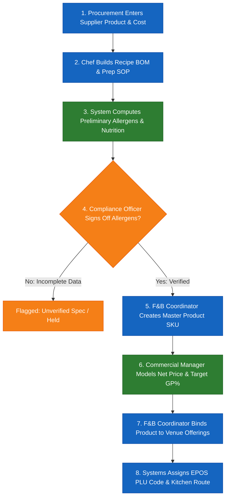
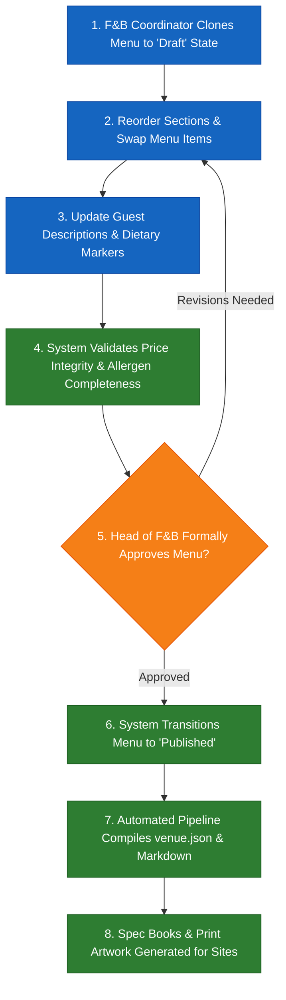
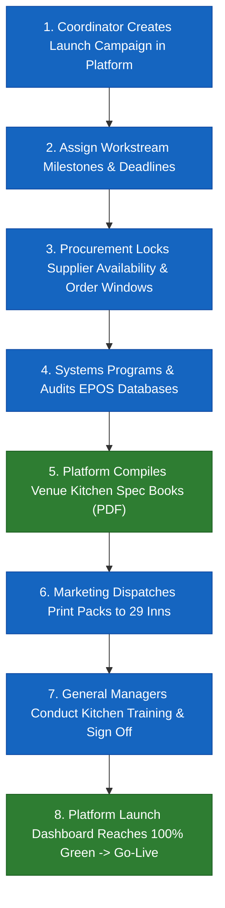
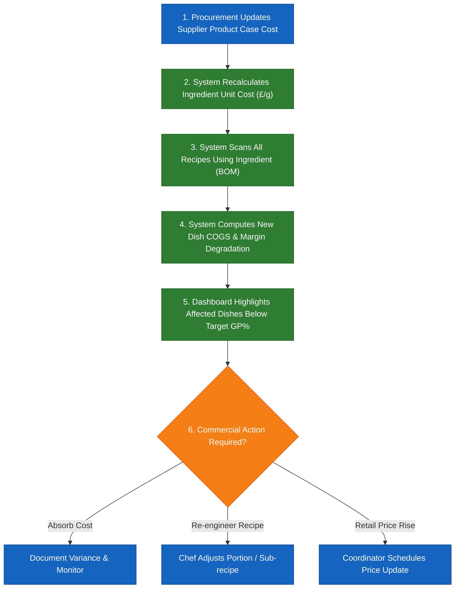
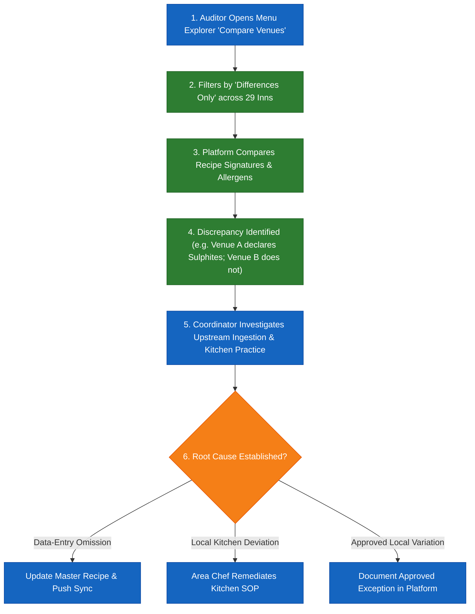
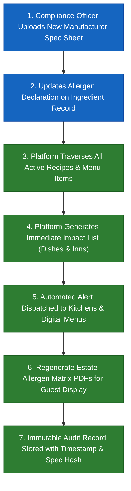
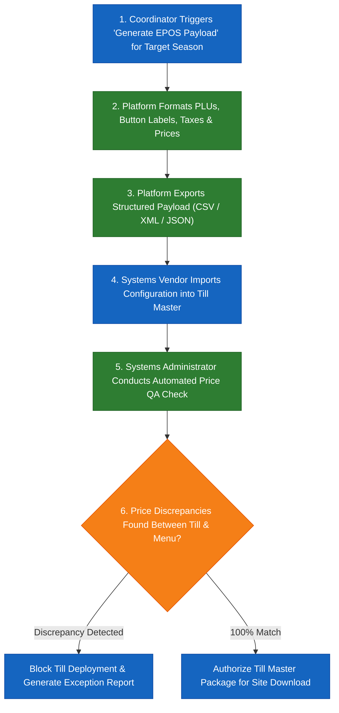

# Document 12 — End-to-End Operational Workflow Design

> **Knowledge Base** · Inn Collection Group (ICG) Hospitality Technology Workspace  
> **Document** 12 of 15 · Published: 2026-11-22  
> **Phase**: Phase 2 — Hospitality Technology Requirements, Target Architecture & Implementation Blueprint  
> **Evidence Standards**: `[Proposed]` · `[Code-verified]` · `[Observed]` · `[Requires-confirmation]`

---

## 1. Executive Summary & Design Principles

This document defines the operational workflows that govern how people and software collaborate within the target Inn Collection Group (ICG) hospitality technology architecture.

A core operational principle guides this workflow specification:
> *"Do not design a system that assumes every operational decision can or should be automated. Software should handle calculation, indexing, cross-referencing, and validation, while humans make culinary, commercial, and food safety decisions."*

Seven core operational workflows are modeled, detailing the exact triggers, roles, system actions, human gates, data mutations, exceptions, and audit criteria across the hospitality lifecycle.

---

## 2. The Seven End-to-End Operational Workflows

```
┌──────────────────────────────────────────────────────────────────────────────────┐
│                   SEVEN CORE HOSPITALITY OPERATIONAL WORKFLOWS                   │
├────────────────────────┬────────────────────────┬────────────────────────────────┤
│ E1. NEW PRODUCT INTRO  │ E2. MENU CHANGE        │ E3. SEASONAL LAUNCH CAMPAIGN   │
│ Supplier -> Recipe ->  │ Proposal -> Recipe ->  │ Milestones -> Spec Books ->    │
│ Allergen -> Price -> Inn│ Price -> Sign-off -> Web│ Till Prep -> Venue Readiness   │
├────────────────────────┼────────────────────────┼────────────────────────────────┤
│ E4. SUPPLIER COST SHIFT│ E5. CROSS-SITE VARIANCE│ E6. FOOD SAFETY & ALLERGENS    │
│ Wholesale Up -> COGS ->│ Compare 29 Inns ->     │ Spec Update -> Recipe Impact ->│
│ Margin Erosion -> Price│ Isolate Kitchen Diverge│ Audit Log -> Menu Re-publish   │
├────────────────────────┴────────────────────────┴────────────────────────────────┤
│ E7. EPOS CONFIGURATION & TILL QA                                                 │
│ Menu Approval -> PLU Assignment -> Modifier Group -> Till Payload -> Price QA     │
└──────────────────────────────────────────────────────────────────────────────────┘
```

---

### 2.1 Workflow E1: New Product Introduction (NPI)

* **Trigger**: Commercial strategy or culinary development proposes a new dish, drink, or retail item to be introduced across estate menus.
* **Participants**: Development Chef, F&B Coordinator, Commercial Manager, Food Safety Compliance Officer.
* **Required Inputs**: Supplier technical specifications, ingredient pricing, kitchen recipe formulation, proposed selling price, target venues.



* **System Actions**:
  1. Converts purchasing pack units (e.g. 6x1kg case) to recipe units (grams).
  2. Aggregates allergen bitmasks across all recipe ingredients into a composite dish allergen profile.
  3. Calculates Cost of Goods Sold (COGS) and gross profit margin ($\text{GP\%}$).
  4. Automatically blocks product publication if `is_pw_allergen_not_set == true`.
* **Human Decisions**:
  1. Chef approves culinary portion sizes, cooking temperatures, and presentation photography.
  2. Compliance Officer formally signs off statutory allergen declarations against supplier documentation.
  3. Commercial Manager approves price point and margin threshold.
* **Data Created / Updated**: `supplier_products`, `ingredients`, `recipes`, `recipe_ingredients`, `commercial_products`, `allergen_declarations`, `prices`, `venue_offerings`.
* **Exceptions**: Missing allergen data from supplier halts workflow at Step 4; low gross profit margin (<68%) triggers commercial review before Step 7.
* **Completion Criteria**: Product record is marked `Active` with signed-off allergens, approved selling price, and mapped PLU code.
* **Audit Requirements**: Immutable entry in `audit_events` with timestamps and user IDs for allergen certification and pricing sign-off.

---

### 2.2 Workflow E2: Menu Change & Price Revision

* **Trigger**: Periodic menu refresh, dish replacement, or planned seasonal menu adjustment.
* **Participants**: F&B Coordinator, Head of F&B, General Managers, Marketing Manager.
* **Required Inputs**: Existing menu hierarchy, proposed dish additions/removals, revised pricing, target publication date.



* **System Actions**:
  1. Clones existing menu into a draft version with full audit history.
  2. Validates that every menu item links to an active commercial product with certified allergens.
  3. Compiles canonical `venue.json` and human-readable `venue.md` per venue upon publication.
  4. Generates updated printable allergen matrices for guest display.
* **Human Decisions**:
  1. Coordinator reviews section balance, pricing flow, and layout constraints.
  2. Head of F&B conducts final sign-off before publication.
* **Data Created / Updated**: `menus`, `menu_sections`, `menu_items`, `approvals`, `exports/<Region>/<Venue>/venue.json`.
* **Completion Criteria**: Menu status changes from `Draft` to `Published`; build pipeline executes cleanly; updated files are pushed to venue interfaces.

---

### 2.3 Workflow E3: Seasonal Menu Launch Orchestration

* **Trigger**: Annual culinary calendar milestone (e.g. 8 weeks prior to Festive or Spring menu changeover).
* **Participants**: F&B Coordinator (Lead), Operations Director, Commercial Manager, Procurement, Area Operations Managers, Site General Managers.
* **Required Inputs**: Seasonal launch calendar, approved menu definitions, marketing print schedule, supplier delivery schedules.



* **System Actions**:
  1. Initializes `launch_campaigns` record and seeds 40+ standard milestone tasks.
  2. Assembles printable kitchen Spec Books (recipe cards, photos, allergens, plating SOPs) via PDF engine.
  3. Computes real-time estate readiness score based on milestone completion across 29 properties.
* **Human Decisions**:
  1. Procurement confirms delivery cut-off dates with suppliers.
  2. Site General Managers verify delivery of print packs and kitchen team training sign-off.
* **Data Created / Updated**: `launch_campaigns`, `launch_tasks`, `launch_venue_statuses`.
* **Completion Criteria**: All 29 inns record 100% readiness sign-off; EPOS terminals verified; launch declared live.

---

### 2.4 Workflow E4: Supplier Cost Change & Recipe Margin Impact

* **Trigger**: Supplier notifies wholesale price increase on a core raw material (e.g. Scottish butter, beef rump, frying oil).
* **Participants**: Procurement Manager, Commercial Manager, F&B Coordinator, Executive Chef.
* **Required Inputs**: Supplier price adjustment notification, affected ingredient codes, effective date.



* **System Actions**:
  1. Updates ingredient unit cost.
  2. Evaluates all recipes containing the ingredient and updates total recipe cost and portion COGS.
  3. Computes revised gross profit percentage against current retail prices.
  4. Generates an exception report listing all dishes where GP% falls below commercial targets (e.g. <70%).
* **Human Decisions**:
  1. Commercial Manager determines whether to absorb the cost, re-engineer the recipe, or raise menu price.
  2. Executive Chef evaluates culinary impact of ingredient substitutions.
* **Data Created / Updated**: `supplier_products.case_cost_net`, `ingredients.unit_cost`, `recipes.cogs_per_portion`, `prices.margin_percentage`.

---

### 2.5 Workflow E5: Cross-Site Variance Auditing

* **Trigger**: Routine menu compliance audit or customer inquiry regarding cross-venue recipe differences.
* **Participants**: Group Executive Chef, Food Safety Officer, F&B Coordinator.
* **Required Inputs**: Generated venue data models across 29 properties (`venue.json`), Menu Explorer dataset.



* **System Actions**:
  1. Cross-references identical dish names across all 29 outlet datasets.
  2. Compares allergen bitmasks, nutritional values, and ingredient declarations.
  3. Renders a side-by-side discrepancy table isolating differences in under one second.
* **Human Decisions**:
  1. Chef determines whether the difference represents an unauthorized kitchen shortcut, supplier substitution, or clerical data-entry error.
  2. Compliance Officer authorizes the required operational remediation.
* **Outputs**: Variance investigation log and corrective action report.

---

### 2.6 Workflow E6: Food Safety & Allergen Information Update

* **Trigger**: Ingredient manufacturer notifies recipe reformulation, change in "may contain" allergen warnings, or new supplier spec sheet.
* **Participants**: Food Safety Compliance Officer, F&B Coordinator, Head of Food.
* **Required Inputs**: Manufacturer technical specification sheet, affected ingredient ID, effective delivery date.



* **System Actions**:
  1. Immediately cascades allergen updates to all child recipes and menu offerings.
  2. Invalidates published allergen matrices and triggers automated PDF re-compilation.
  3. Records SHA-256 hash of supplier specification in audit history.
* **Human Decisions**:
  1. Compliance Officer certifies the authenticity and regulatory validity of the change.
* **Data Created / Updated**: `ingredients.allergen_bitmask`, `allergen_declarations`, `source_documents`, `audit_events`.
* **Completion Criteria**: All digital menus reflect the updated allergen status; new physical matrices printed for venue display.

---

### 2.7 Workflow E7: EPOS Configuration Preparation & Till QA

* **Trigger**: Menu publication completed; till system must be programmed 2 weeks prior to menu launch.
* **Participants**: F&B Coordinator, Systems Administrator, Till Programming Vendor.
* **Required Inputs**: Approved menu item hierarchy, retail pricing tiers, kitchen printer routing rules.



* **System Actions**:
  1. Maps `venue_offerings` to target EPOS schema (PLU, category, price, VAT rate 20%, printer group).
  2. Executes pre-release price comparison between EPOS database and approved menu specs.
* **Human Decisions**:
  1. Systems Admin authorizes release of till package following 100% validation pass.
* **Outputs**: EPOS configuration export payload; Till QA Verification Certificate.
