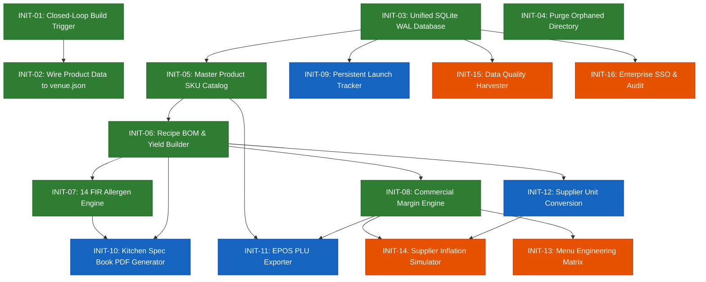

# Document 14 — Implementation Roadmap and Prioritisation

> **Knowledge Base** · Inn Collection Group (ICG) Hospitality Technology Workspace  
> **Document** 14 of 15 · Published: 2026-11-22  
> **Phase**: Phase 2 — Hospitality Technology Requirements, Target Architecture & Implementation Blueprint  
> **Evidence Standards**: `[Proposed]` · `[Code-verified]` · `[Database-verified]`

---

## 1. Executive Summary & Phasing Strategy

This document establishes the implementation roadmap for delivering the target Inn Collection Group (ICG) hospitality technology platform.

A pragmatic implementation principle guides this roadmap:
> *"Prioritize functional completeness over cosmetic enhancements. Deliver a small, working, end-to-end operational workflow before attempting to build an entire enterprise suite."*

Rather than embarking on a monolithic multi-month redevelopment, the roadmap is organized across **four value-driven execution phases**, culminating in the immediate definition of a **"Walking Skeleton"** (the smallest meaningful end-to-end capability).

---

## 2. The Four Implementation Phases

```
┌──────────────────────────────────────────────────────────────────────────────────┐
│                          FOUR-PHASE IMPLEMENTATION ROADMAP                       │
├──────────────────────────────────────────────────────────────────────────────────┤
│ PHASE 1: FOUNDATION & CANONICAL PERSISTENCE (Weeks 1–3)                          │
│ • Unified SQLite WAL Database Schema • Closed-Loop Review-to-Export Rebuild       │
│ • Canonical venue.json Wired to Product UI • Orphaned Markdown Directory Purged  │
├──────────────────────────────────────────────────────────────────────────────────┤
│ PHASE 2: CORE OPERATIONAL MODULES (Weeks 4–7)                                    │
│ • Master Product Catalog & SKU Engine • Recipe BOM Formulation & Yields          │
│ • 14 FIR Allergen Governance & Un-set Flags • Commercial Pricing & Margin Engine │
├──────────────────────────────────────────────────────────────────────────────────┤
│ PHASE 3: WORKFLOW ORCHESTRATION & SYSTEMS PREP (Weeks 8–11)                      │
│ • Seasonal Launch Campaign Master & Task RAG • Kitchen Spec Book PDF Generator   │
│ • EPOS PLU Mapping & Till Config Exporter • Supplier Purchasing Unit Conversions │
├──────────────────────────────────────────────────────────────────────────────────┤
│ PHASE 4: ADVANCED INTELLIGENCE & INTEGRATION (Weeks 12+)                         │
│ • Menu Engineering Performance Matrix (Stars/Dogs) • Supplier Cost Inflation     │
│ • Automated Data Quality Harvester • Enterprise Single Sign-On (OIDC)            │
└──────────────────────────────────────────────────────────────────────────────────┘
```

---

## 3. The "Walking Skeleton": Smallest Meaningful End-to-End Capability

To validate the architecture early and provide immediate operational utility to the F&B Coordinator, the very first deliverable (Sprint 1) will be a complete **Walking Skeleton**:

### The End-to-End Thread:
```
[Menu Review UI]
      │ 1. Coordinator remediates duplicate line in menu markdown
      ▼
[menu_review_server.py]
      │ 2. Atomically rewrites markdown & updates SQLite issue_reviews
      │ 3. Automated hook immediately triggers build_venue_export.py
      ▼
[venue.json]
      │ 4. Recompiled canonical venue model updates coverage & products
      ▼
[Product Data UI (pages/product-data.html)]
      │ 5. Reads recompiled venue.json:products[] via GET /api/products
      ▼
[Verified Outcome]
A document edit in Menu Review instantly reflects in the Master Product Catalog!
```

* **Operational Value**: Closes the broken loop between quality control and product cataloging, proving the end-to-end data pipeline without requiring complex new frameworks.

---

## 4. Initiative Breakdown & Prioritization Register

Every technical capability in the roadmap is cataloged below with dependencies, complexity, risk, and verification criteria:

| Initiative ID | Phase | Capability Description | Operational Value | Existing Foundation | Dependencies | Complexity | Risk | Priority | Acceptance Criteria | Required Evidence |
| :--- | :---: | :--- | :--- | :--- | :--- | :---: | :---: | :---: | :--- | :--- |
| **INIT-01** | **1** | **Closed-Loop Build Trigger** | When Menu Review fixes a menu, automatically re-run `build_venue_export.py`. | `POST /api/issues/fix-duplicates` in `menu_review_server.py` | None | **Low** | **Low** | **P1** | Fixing duplicate line updates `venue.json` without manual terminal command. | `[Runtime-tested]` file timestamp & hash |
| **INIT-02** | **1** | **Wire Product Data UI to `venue.json`** | Replace static mock table in `product-data.html` with records from `venue.json:products[]`. | `pages/product-data.html` UI layout | INIT-01 | **Low** | **Low** | **P1** | Product page renders live products with match scores, allergens, and photos. | `[Observed]` in browser |
| **INIT-03** | **1** | **Unified SQLite WAL Database** | Initialize master SQLite tables (`venues`, `products`, `recipes`, `menus`, `prices`). | `menu_review_state.sqlite3` | None | **Medium** | **Low** | **P1** | Relational tables exist; SQLite WAL mode active; ACID transactions verified. | `[Database-verified]` SQL schema inspection |
| **INIT-04** | **1** | **Purge Orphaned Markdown Directory** | Safely delete `pages/menus_md/` duplicate folder upon business confirmation. | 103 identical files in 2 directories | Business approval | **Low** | **Low** | **P1** | Master menus live solely in `inncollectiongroup.com_root/menus_md/`. | `[File-verified]` directory check |
| **INIT-05** | **2** | **Master Product SKU Catalog** | Interactive UI and REST API (`GET/POST /api/products`) to register commercial products. | Prototype wireframe | INIT-03 | **Medium** | **Low** | **P1** | Can create, edit, search, and filter commercial products by category and brand. | `[Runtime-tested]` API HTTP 200 & SQL write |
| **INIT-06** | **2** | **Recipe Specification & BOM Builder** | Structured recipe editor capturing ingredients, quantities, prep steps, and yields. | Kafoodie crawl / Parfait demo | INIT-03, INIT-05 | **High** | **Medium** | **P1** | Chef can build sub-recipes and calculate composite ingredient quantities. | `[Runtime-tested]` Recipe creation workflow |
| **INIT-07** | **2** | **14 Statutory Allergen Compliance Engine** | Automated allergen bitmask calculation and un-set allergen gate (`is_pw_allergen_not_set`). | Allergen dictionary in `menu-explorer` | INIT-06 | **Medium** | **High** | **P1** | System prevents publication of dishes with incomplete allergen declarations. | `[Runtime-tested]` Rejection of un-set dish |
| **INIT-08** | **2** | **Commercial Price & Margin Engine** | Automatic COGS calculation from recipe BOM; Gross Profit % modeling with 20% VAT. | Pricing tokens in menus | INIT-06 | **Medium** | **Low** | **P1** | Displaying selling price instantly calculates net price, COGS, and GP% margin. | `[Runtime-tested]` Correct math verification |
| **INIT-09** | **3** | **Seasonal Launch Campaign Master** | Wire `launch-readiness.html` milestone checkboxes to SQLite `launch_tasks` table. | `pages/launch-readiness.html` | INIT-03 | **Medium** | **Low** | **P2** | Checkbox state persists across reloads; RAG status updates dynamically. | `[Runtime-tested]` Persistence check |
| **INIT-10** | **3** | **Automated Kitchen Spec Book PDF Generator** | Generate printable kitchen spec packs (recipe cards, allergens, SOPs) via WeasyPrint. | Parfait layout / PDF.js | INIT-06, INIT-07 | **High** | **Medium** | **P2** | One-click download of multi-page PDF spec book matching brand standards. | `[Runtime-tested]` Generated PDF inspection |
| **INIT-11** | **3** | **EPOS PLU Mapping & Config Exporter** | Assign PLU codes, button labels, and export structured till payloads (CSV / XML). | Venue offering data | INIT-05 | **Medium** | **Medium** | **P2** | Generates validated EPOS programming file ready for till system upload. | `[Runtime-tested]` Exported payload audit |
| **INIT-12** | **3** | **Supplier Pack-to-Kitchen Conversion** | Manage supplier case sizes and automatically calculate recipe unit costs (£/g). | Mockup in Parfait | INIT-06 | **Medium** | **Low** | **P2** | Changing supplier case cost automatically updates all recipe portion costs. | `[Runtime-tested]` Cascade recalculation |
| **INIT-13** | **4** | **Menu Engineering Matrix (Stars/Dogs)** | Import sales mix quantities to classify dishes into Stars, Plowhorses, Puzzles, Dogs. | Mentioned in notes | Sales data feed | **High** | **Medium** | **P3** | Interactive scatter plot mapping sales popularity against gross profit margin. | `[Observed]` Visual chart rendering |
| **INIT-14** | **4** | **Supplier Cost Inflation Simulator** | Simulate estate-wide financial impact of wholesale ingredient price increases. | Costing engine | INIT-08, INIT-12 | **Medium** | **Low** | **P3** | Modeling 10% butter increase highlights margin impact across all 29 inns. | `[Runtime-tested]` Financial forecast |
| **INIT-15** | **4** | **Automated Data Quality Harvester** | Scheduled background scanner identifying missing photos, un-set tags, and pricing drift. | `venue.json:coverage` | INIT-03 | **Medium** | **Low** | **P3** | Dashboard alerts F&B Coordinator to data gaps prior to launch windows. | `[Runtime-tested]` Exception report |
| **INIT-16** | **4** | **Enterprise SSO (OIDC) & Audit Trail** | Authenticate users via corporate Identity Provider and log tamper-evident audit events. | Local user table | Corporate IdP | **High** | **Medium** | **P3** | Users log in via corporate SSO; all writes record user ID in `audit_events`. | `[Runtime-tested]` Auth token & audit log |

---

## 5. Dependency Architecture & Sequencing


